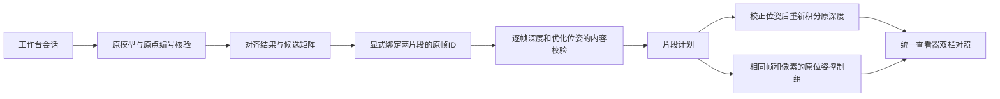

# 从对应点核验到原帧重融合

当前已经实现并验证了这个离线闭环：



这一步会重新读取深度图并运行TSDF，生成新的表面。表面对齐程序单独输出的PLY仍只是刚体移动后的表面。原帧绑定、输入核验和两组融合已于2026-10-22接入工程工作区的对应点模式；[网页使用方法](web-fragment-workflow.md)。下文保留底层JSON、CLI和固定工作流契约。

## 输入数据和坐标约定

仅支持同一份解包索引中的两个明确片段。源、目标模型都必须保留原保存扫描坐标，以毫米为单位；选定的矩阵将源片段校正到固定目标片段。不能把显示点序号当成帧号，不能把已居中或归一化的模型直接绑定到原位姿。归属依据需要明确写出，并由操作者确认；程序不会从PLY外形推断。

1. `decoded/index.json` 提供扫描ID、原帧ID、标定与光学轴转换约定。索引文件的SHA必须固定。
2. 每个选中帧提供 `frame_XXXXXXXXXX/frame.npz` 和 `pose_optimized.npy`。深度、有效像素对应颜色、位姿都实际读取检查，再记录每份文件的SHA。
3. `apply_landmark_alignment.py` 的结果目录提供 `summary.json` 与 `session-original.json`。桥接会重新核验原始点或已有候选的来源；可显式选择原对应点结果或其另存的ICP候选。
4. 单独的绑定JSON声明帧归属、模型SHA、保存坐标依据、选择决定，以及可选原坐标ROI。跨片段重复帧、未知帧、错误索引、镜像或缩放矩阵、丢失文件都会阻止执行。

绑定文件的最小结构如下。SHA和帧号是占位说明，必须使用实际输入，不能直接运行：

```json
{
  "format_version": 1,
  "unit": "mm",
  "scan_id": "scan_example",
  "decoded_index_sha256": "索引原字节的64位小写SHA256",
  "alignment_summary_sha256": "核验后summary.json原字节的SHA256",
  "decision": "说明为什么选择这两个片段、这个候选和这些帧",
  "target": {
    "path": "reports/example/target.ply",
    "sha256": "目标模型SHA256",
    "frame_ids": [0, 1, 2],
    "coordinate_frame": "saved_scan_mm",
    "basis": "生成目标模型的脚本和分段记录证明其保存坐标及对应帧范围"
  },
  "source": {
    "path": "reports/example/source.ply",
    "sha256": "源模型SHA256",
    "frame_ids": [8, 9, 10],
    "coordinate_frame": "saved_scan_mm",
    "basis": "生成源模型的脚本和分段记录证明其保存坐标及对应帧范围"
  }
}
```

可增加 `selection_roi_original_scan_mm: [[xmin,ymin,zmin],[xmax,ymax,zmax]]` 和 `input_sha256: {"来源文件路径":"SHA256"}`。如果模型只由训练帧生成，而融合选择整个片段，必须在依据中明确说明；这些帧随后全部参加融合，不能再称为独立留出测试。

## 运行方法

在项目根目录执行，所有输出使用新目录：

```powershell
# 先核验/应用工作台会话。路径适配只在内存中处理旧路径。
.\.venv\Scripts\python.exe -m reconstruction_probe.path_mapping --workspace . --session reports/example/session.json --out reports/example/alignment

# 生成包含逐帧输入SHA的计划。
.\.venv\Scripts\python.exe scripts/build_fragment_plan_from_alignment.py --decoded reports/example/decoded --alignment reports/example/alignment --binding reports/example/binding.json --candidate manual_landmarks --out reports/example/plan

# 同一计划分别运行原位姿控制组与片段校正组。
.\.venv\Scripts\python.exe scripts/reconstruct_fragment_plan.py --decoded reports/example/decoded --plan reports/example/plan/fragment-plan.json --saved-control --out reports/example/saved
.\.venv\Scripts\python.exe scripts/reconstruct_fragment_plan.py --decoded reports/example/decoded --plan reports/example/plan/fragment-plan.json --out reports/example/corrected
```

固定工作流新增 `fragments.plan` 与 `fragments.fuse`。后者的 `plan` 可以引用前一步的 `fragment-plan.json`；`saved_control: true` 运行控制组。依赖文件改动会阻止继续执行，取消在步骤之间生效。每步分别保存参数、脚本哈希、输入输出哈希与日志，不调用任意shell命令，也未接入语言模型。

## 处理逻辑与验收

目标片段的校正为单位阵；源片段的校正为核验后的源到目标矩阵。新的相机到扫描位姿为 `片段校正 × 原优化位姿`。再按照原索引的光学轴约定和标定，将同一深度图积分到新的TSDF。

ROI始终通过原优化位姿计算，保证校正组和控制组选择同一批原像素。每个选中帧只积分一次，未选中的帧保留。计划和索引的哈希直接来自实际解析的那份字节。引用文件检查通过后仍保留预期SHA，避免把检查期间出现的新版本重新记为基线；融合结束再次核对这些相同输入。输出 `selected_depth_with_frame_ids_sha256`；对照必须同时比较原帧ID、帧数和这个摘要，而不只比较模型点数。

当前融合参数为0.6mm体素、2.4mm截断、3mm深度跳变筛除、提取权重3。它们沿用已验证的研究设置，尚未提供网页参数编辑。

## 真实数据验证与限制

失败杯子工程 `scan_20261018131222` 的片段0和1，共114帧，已从核验后的既有候选、显式来源绑定一路重走原帧融合。另222条保存记录未加入。两组输入摘要相同：

```text
5c899c637d54df68f358d9bcdb597689ce32b97a08f0d2031de2cd8a8e621736
```

原位姿组67,226点，校正组66,376点。两组相对于各自之前的冻结结果，全部点的双向最近邻最大距离均为0mm；这证明新的执行链路忠实复现旧结果，不能当作扫描精度为0mm或新的修复效果提升。真实验证使用自动回放已有候选，没有冒充人工选点。

复现命令：

```powershell
.\.venv\Scripts\python.exe scripts/check_fragment_bridge_live.py --out reports/new-bridge-verification
```

本地最终完整记录位于 `reports/web-studio/sync-20261021/final-bridge/`；早期验证保留在 `reports/range2-study-20261018/experiments/fragment-bridge-20261021/verified/`。实验当前入口为后者父目录的 `current-review.html`。`review.html` 复用Web Studio的查看器、选点算法和CPU兼容绘制；生成时嵌入代码SHA。双栏可以联动旋转、缩放和选取各自模型的原顶点。页面原色和伪彩不改变源数据；伪彩在各模型内归一化，仅作观察。

2026-10-22网页真实接口回放也复现了相同114帧与两组表面，见[本轮验证](../research/verification/2026-10-22-web-fragments/README.md)。模型结果版本与切换撤销已于2026-10-23接入，见[工程版本说明](project-result-history.md)。仍需继续：跨工程坐标契约、完整帧/参数编辑历史、独立的几何质量评测。整个336帧失败扫描尚未修好。本次实际统一查看器CPU像素检查与浏览器/GPU验证分别记录。
