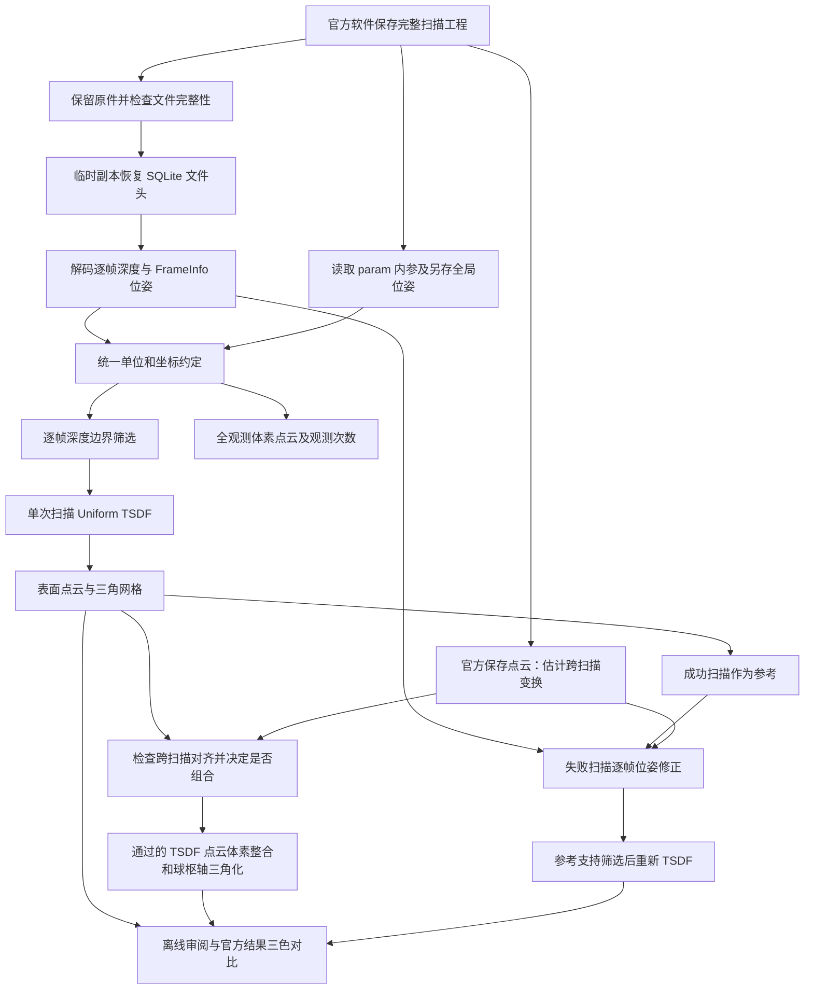

# 从离线工程解包到融合重建：完整链路与使用手册

更新日期：2026-10-17。本文按照当前仓库的实际代码、四份原始工程和已生成的报告编写。命令面向 Windows PowerShell，工作目录为项目根目录。

**新增数据说明（2026-10-19）：** 本文的二进制布局和 Y/Z 翻转示例针对旧四份工程。2026-10-18 新扫描使用属性表、20 字节深度头、132 字节位姿；实测光学到位姿轴为 `[1,1,1]`，无需旧示例中的 Y/Z 翻转。颜色字节按 `A,B,G,R` 解释，原始 JPEG 的标准解码与保存 PLY 红蓝相反。请配合 [新工程研究记录](range2-study-20261018.md) 使用，不能只根据设备型号选择格式。

初次理解数据怎样变成三维模型，可先阅读 [从解包到点云：直观理解版](unpacking-to-pointcloud-explained.md)。

## 1. 我们现在已经跑通了什么

当前链路是：**官方软件扫描并保存完整工程 → 读取工程中保存的深度、标定和位姿 → 我们重新进行多帧融合 → 提取点云和网格 → 对不同扫描进行配准与组合 → 交互检查结果。**

因此，现有单次扫描模型确实由数据库中的逐帧深度重新计算得到。我们实现的是离线重建和后处理，没有重新实现扫描仪驱动、设备原始双目测深或厂商的跟踪算法。

需要区分几种数据依赖：

| 结果 | 几何输入 | 位姿或对齐来源 | 当前实现 |
| --- | --- | --- | --- |
| 单次扫描 TSDF 基线 | 本工程保存的逐帧深度 | 本工程保存位姿；有全局位姿时优先使用 | 自己重新融合，官方 PLY 只在结果生成后用于比较 |
| 全观测体素点云 | 本工程所有可用的深度观测 | 同上 | 投影后按体素累计坐标和观测次数 |
| 多次扫描组合候选 | 各工程独立生成的 TSDF 点云 | 当前先用官方输出估计跨扫描变换，再检查 TSDF 的对齐情况 | 对齐、体素整合、重新三角化 |
| 失败扫描参考辅助候选 | 失败工程深度，另加成功扫描作为参考 | 对每帧位姿做有限度修正 | 参考约束、像素筛选、重新 TSDF |
| 官方输入云的 Poisson 实验 | 官方保存的融合云或预览云 | 跨扫描配准 | 单独保留的后处理实验，不能算作原始深度独立重建 |

这里的“独立重建”指**没有用官方最终点云或网格生成该次 TSDF 表面**，仍然依赖官方工程保存的深度和位姿。

## 2. 总体处理图



单次 TSDF、跨扫描组合和参考辅助修正是三个不同阶段，输出分目录保存。通过配准门限才会进入组合；没有通过的扫描仍保留原结果和诊断信息。

## 3. 输入是什么：要完整工程，不能只拿一个模型文件

当前使用的工程大致如下：

```text
item/
├─ share/
│  └─ 20261015_标准模型/
│     ├─ *.revox
│     ├─ cache/
│     │  └─ frames.dataset
│     ├─ param/
│     │  ├─ Pl.bin
│     │  ├─ Prgb.bin
│     │  └─ 其他标定文件
│     ├─ raw_preview.ply
│     ├─ pointclouds/fuse.ply       # 某些工程没有
│     └─ meshs/fuse_mesh.ply        # 某些工程没有
├─ share(1)/四分之一turmp/...
├─ share(2)/成功的川普/...
└─ share(3)/失败的trump/...
```

这批 `.revox` 是 JSON 工程描述文件；主要逐帧数据在外部的 `cache/frames.dataset`，相机参数在 `param/`。单独复制 `.revox` 或导出的 PLY，不能替代完整原始工程。

ZIP 解压和数据库解码是两个步骤。当前四份 ZIP 已经解压；`decode_scan_projects.py` 不负责解压 ZIP，应保留压缩包内部的完整目录结构。

当前四份数据的读取情况：

| 编号 | 工程名称 | 深度帧 | 保存位姿记录 | 另存全局位姿 | 有效深度像素观测 |
| --- | --- | ---: | ---: | ---: | ---: |
| scan_01 | 20261015_标准模型 | 816 | 817 | 0 | 17,606,410 |
| scan_02 | 四分之一turmp | 54 | 54 | 0 | 2,610,964 |
| scan_03 | 成功的川普 | 886 | 886 | 886 | 44,922,265 |
| scan_04 | 失败的trump | 742 | 743 | 0 | 38,265,522 |
| 合计 | | **2,498** | **2,500** | **886** | **103,405,161** |

以上是数据库实际保存的数据，不等于设备物理采集过的全部帧。工程中的 `vf_count` 与深度帧数不同，目前没有足够证据说明官方究竟在哪个阶段保留、合并或丢弃过哪些采集帧。

四份工程均无原始 RGB 纹理：`FrameColor` 表为空，深度载荷也没有 RGBA。界面的灰色、扫描来源配色和差异配色都是显示颜色。

`scan_01` 是否为官方示例、是否与其他工程是同一物体，仍待确认。当前几何匹配未通过，因此单独保留；不能仅凭名称、相同设备标识或相同 `scan.guid` 判断身份或共同坐标系。

## 4. 解包阶段的具体逻辑

实现入口：[decode_scan_projects.py](../scripts/decode_scan_projects.py)；底层格式解析在 [offline.py](../src/reconstruction_probe/offline.py) 和 [poses.py](../src/reconstruction_probe/poses.py)。

### 4.1 只读打开数据库

`frames.dataset` 使用了可识别的 RPAlgo 文件头。程序会：

1. 记录原工程文件的 SHA256。
2. 将数据库复制到系统临时目录。
3. 仅在副本中，把开头的 `RPAlgo_file_sys\0` 恢复为 SQLite 标准文件头。
4. 以只读方式打开副本，启用 `query_only`，执行数据库完整性检查。
5. 读取完毕后关闭连接并清理临时副本，再核对原件哈希。

这一步是已知格式的文件头恢复与二进制解析，并非对加密数据进行密码学解密。原数据库不会被改写。

### 4.2 从稀疏载荷恢复深度图

当前样例的 `FrameRGBD.data` 是 sparse v0 布局：

```text
16 字节头：width、height、有效像素数、载荷 kind，均为小端 uint32
像素有效性位图：每像素 1 bit，低位优先
有效深度序列：小端 float32，单位 mm
可选 RGBA：仅实际 kind 表示存在时读取
```

程序按位图将深度填回 `H×W` 数组：有观测的位置保留原始 float32 毫米值，其余位置为 0。当前全部为 `300×400` 数组。

解析会检查尺寸、载荷长度、位图有效数量、填充位、深度是否有限且为正等条件；未知版本或不一致的数据会记录错误。SQL 列名 `FrameRGBD` 或 `type=1` 本身不能证明保存了彩色图像。

### 4.3 从二进制记录恢复位姿

`FrameInfo` 的普通 SQL 位姿列在这批数据里是空的，实际矩阵位于 `bin` 中。当前解析器支持：

- 本批使用的 **164 字节紧凑布局**：前 16 字节为头，偏移 16 处是 16 个 float64 构成的 4×4 矩阵，最后 20 字节原样保留。
- 早期书本样例使用的**可变长数组布局**：根据数量字段计算后续偏移，不能把所有记录都当作固定 292 字节。

矩阵必须满足有限值、最后一行接近 `[0,0,0,1]`、旋转部分正交且行列式接近 1。**矩阵格式合法不表示跟踪一定正确**；失败扫描也可以包含格式完全合法、几何上存在漂移的位姿。

仅有位姿、没有深度的两条记录会另存到 `pose_only/`，不会伪造对应深度帧。

`scan_03` 还包含 `global_register_pose.pose`。它保存数量及若干“ID 高字、ID 低字、4×4 float64 矩阵”；ID 按 `(high << 32) | low` 组合，再与深度帧匹配。解包同时保存逐帧原位姿和这套全局位姿，不覆盖原记录。

### 4.4 解包结果的数据结构

```text
decoded/
├─ summary.json
└─ scan_03/
   ├─ index.json
   ├─ poses.csv
   ├─ frame_0000000001/             # 数字是原记录 ID，不保证连续或从 1 开始
   │  ├─ frame.npz
   │  ├─ frame.json
   │  ├─ frame_info_bin.bin
   │  ├─ pose_stored.npy
   │  └─ pose_global_registration.npy   # 仅存在匹配全局位姿时
   └─ ...
```

| 文件 | 内容与用途 |
| --- | --- |
| `index.json` | 来源目录、内参、帧索引、解析状态、错误、原件哈希 |
| `frame.npz` | `depth_mm`：float32 深度图；若载荷真实包含颜色才有 `rgba` |
| `frame.json` | 原帧 ID、深度和位姿状态、深度范围、未知头尾字节及来源字段 |
| `frame_info_bin.bin` | 原始序列化位姿记录，供复核和后续格式研究 |
| `pose_stored.npy` | 原保存 4×4 矩阵，float64，平移单位 mm |
| `pose_global_registration.npy` | 另存全局配准矩阵，不与原矩阵混写 |
| `poses.csv` | 行展开矩阵；`kind` 区分 stored、global_registration_file、stored_pose_only |

解包成功应查看 `summary.json` 和每份 `index.json` 的 `status`、`errors`、`source_unchanged`。脚本能够记录单帧错误并继续，因此不能只凭进程退出码认定全部帧成功。

## 5. 从深度像素到三维点：内参、位姿与坐标系

### 5.1 内参缩放

当前读取每个工程自己的 `param/Pl.bin`，得到标定图像大小和内参矩阵。若标定尺寸为 `Wc×Hc`、深度尺寸为 `W×H`，则：

```text
fx = fx_calib × W/Wc       cx = cx_calib × W/Wc
fy = fy_calib × H/Hc       cy = cy_calib × H/Hc
```

不能直接把标定分辨率的内参用于另一尺寸深度图。程序也读取 `Prgb.bin`，但当前无 RGB 数据，没有进行颜色映射。

`Q.bin`、`Distort.bin`、`LC_RT.bin` 等其余标定文件保留在原工程中；当前主重建链路没有使用它们重新计算双目深度或执行额外畸变矫正。现有投影关系经过这四份数据的几何一致性检查，其他型号或编码仍需重新验证。

### 5.2 反投影与保存坐标的转换

对深度值 `z>0` 的像素 `(u,v)`：

```text
p_optical = [(u-cx)×z/fx, (v-cy)×z/fy, z]
S = diag(1, -1, -1, 1)
p_scan = M_saved × S × [p_optical, 1]
```

`S` 同时翻转 Y、Z，相当于绕 X 旋转 180°；这是当前四份样例已验证的约定。不要对已经输出到扫描坐标系的 PLY 再翻转一次。

默认位姿选择顺序是：有匹配的另存全局位姿则使用它，否则使用 `FrameInfo.bin` 的第一矩阵。当前只有 `scan_03` 使用另存全局位姿。重建参数 `--stored-only` 可关闭全局位姿优先，便于对照实验。

### 5.3 TSDF 的单位和矩阵方向

解包深度、保存位姿平移以及最终 `*_mm.ply/obj` 使用**毫米**。Open3D TSDF 内部使用**米**：

```text
M_m = M_saved，其中平移分量除以 1000
camera_to_scan = M_m × S
Open3D extrinsic = inverse(camera_to_scan)
depth_scale = 1000
```

Open3D 接收的是扫描坐标到相机的外参，所以要取逆；如果矩阵方向或米/毫米混用，模型通常会散开、翻转或出现千倍尺度错误。当前 RGBD 构造还设置了 2 m 深度截断，超过该范围的观测不会积分，虽然解码层可能读取到它们。

保存矩阵的平移可给出相机原点在扫描参考系中的位置。但没有可靠采集时间戳，也未确认转台或物体运动的物理参考系，因此目前可以按 ID 顺序检查轨迹，不能据此还原真实扫描速度或声称获得绝对世界轨迹。

## 6. 单次扫描：两条互补的融合分支

### 6.1 主输出：Uniform TSDF 表面重建

实现：[reconstruct_scans.py](../scripts/reconstruct_scans.py)。

处理顺序如下：

1. 根据帧索引和 `--stride` 选择深度帧，默认步长 1，即处理全部保存深度帧。
2. 根据深度投影和位姿估计包围范围，增加总边长 12 mm 的余量，构建立方体体积。
3. 在每帧中查找相邻有效像素的深度突变；默认相差超过 3 mm 时，双方像素暂不参加 TSDF。
4. 将深度、内参和外参送入 Open3D `UniformTSDFVolume`，累积表面附近的截断有符号距离。
5. 从累积距离场提取表面点云和零交叉三角网格，清理重复、退化三角形并计算法线。
6. 保存模型、参数、逐帧积分状态及质量统计；此后才读取官方 PLY 做一致性比较。

可以把 TSDF 理解为：多帧都在估计“某个空间体素位于表面前面还是后面、距离多少”，再将这些估计累积；最终距离接近零的位置成为表面。其核心是距离场的加权更新：

```text
D_new = (W_old × D_old + w × d_frame) / (W_old + w)
```

这只是算法原理表达；当前积分与权重管理由 Open3D 实现，没有额外实现经过标定的置信度模型。

**TSDF 输出不是原始测量点的简单并集。** 它会聚合、平滑并插值得到表面，部分孤立观测不会出现在表面结果中。没有观测到的区域无法靠融合变成已知真实表面；邻近错误观测也可能形成桥接或重复壳层。

当前采用 Uniform TSDF，是因为本机安装的 Scalable TSDF 在真实输入和人工平面对照中都返回空表面，而 Uniform 通过了对照。不能据此推断 Scalable TSDF 在所有环境中都有同样问题。

| 参数 | 默认值 | 含义与影响 |
| --- | ---: | --- |
| `--voxel-mm` | 0.6 | 请求体素边长；越小越细，但体积分辨率上限会限制实际值 |
| `--truncation-mm` | 2.4 | 请求 TSDF 截断距离；实际至少为实际体素的 4 倍 |
| `--edge-mm` | 3 | 相邻有效深度的突变筛选阈值；非正值关闭该筛选 |
| `--stride` | 1 | 每隔多少帧处理一次；大于 1 适合快速试验，会减少输入 |
| `--stored-only` | 关闭 | 开启后只用逐帧原保存位姿，不优先使用全局位姿文件 |

体积每边分辨率当前限制为 64～256。若物体或错误漂移范围较大，请求 0.6 mm 不保证得到 0.6 mm；必须查看 `reconstruction.json` 的实际 `voxel_mm` 和 `sdf_truncation_mm`。本批实际体素为约 0.685～0.838 mm。

TSDF 基线信任保存位姿，不自动修复轨迹漂移，也没有执行显式封闭填洞。

### 6.2 诊断输出：全观测体素累计

实现：[fuse_depth_points.py](../scripts/fuse_depth_points.py)。

这条分支将所有有可用位姿的有效深度像素投影到扫描坐标，不做 TSDF 的深度边界筛选，再按固定体素累计坐标之和与像素观测次数：

```text
体素代表点 = 该体素内所有投影观测的坐标和 / 观测次数
```

它保留背景和跟踪错误，适合检查“测量里本来有什么、TSDF 没保留什么”。压缩后的体素点不是每个原始像素逐一存档；逐帧原始值仍在解包数组中。

输出 `voxel_support.npz` 包含：

- `points_mm`：`N×3` 体素代表点。
- `observation_counts`：每个体素累计的像素观测次数。

当前代码检查次数之和等于参与处理的有效像素观测总数，且跨批累计按次数加权。次数多不代表来自更多独立视角，也不是可直接解释为概率的“可信度”。

如果同目录已有 TSDF 网格，脚本还导出 `tsdf_dominant_component_candidate_mm.ply`，仅保留最大连通片。它只是待审阅候选；`scan_02` 最大连通片仅占约 48.86% 三角，自动替换会丢掉可能真实的分离片段。

## 7. 多次扫描：先配准，再决定是否组合

实现：[register_scans.py](../scripts/register_scans.py)。当前参考工程为 `scan_03`。

### 7.1 当前跨扫描变换怎样得到

先读取官方 `pointclouds/fuse.ply`；若没有保存融合云，则使用 `raw_preview.ply`，并在报告中记录来源。文件复制到输出目录的 `staged_inputs/`，校验副本哈希，以规避本机部分 Open3D 文件接口的中文路径问题。

随后执行去重、非有限值清理、体素降采样、统计离群点筛选和法线估计，再尝试质心平移、PCA 轴排列、多组 FPFH/RANSAC 与 FGR 初值，用多尺度点到平面 ICP 细化。候选按覆盖率、距离和法线情况评估，不能只看 ICP 的一个 fitness 数值。

默认 `--voxel 1` 时，整份扫描进入组合需满足的主要门限为：

| 检查 | 默认要求 |
| --- | --- |
| 变换合法性 | 有限的正规刚体变换 |
| 源扫描到参考，1 mm 内覆盖 | ≥60% |
| 源扫描到参考，2.5 mm 内覆盖 | ≥85% |
| 源扫描到参考距离中位数 | ≤1 mm |
| 重叠区法线绝对点积中位数 | ≥0.85 |

报告仍保留反向指标。局部扫描能很好覆盖参考的一部分，但参考不一定能被局部扫描完整覆盖，因此不能要求两方向覆盖比例相同。门限是当前启发式规则，不证明物体身份或测量精度。

变换保存在 `scan_XX_registration.json` 的 `transform_source_to_reference` 中，单位 mm；它把源工程坐标变为参考工程坐标。单次重建模型各自的坐标系不同，即使扫描了同一物体也不能直接叠加。

### 7.2 对我们自己的 TSDF 结果再检查一次

第二次调用脚本并指定 `--raw-tsdf-root` 时，会读取第一阶段已保存的变换，把各工程自己的 TSDF 点云变到参考系，重新统计重叠和残差，决定组合成员。

本批 `scan_02 + scan_03` 通过；`scan_04` 整份未通过；`scan_01` 当前匹配未通过、身份待确认。拒绝的扫描不会整份加入组合，变换候选和诊断仍保留。

### 7.3 最终组合到底做了什么

对于通过的 TSDF 点云，当前执行：

```text
刚体变换 → 合并表面采样 → 体素平均 → 统计筛选
→ 法线估计与方向整理 → 球枢轴三角化 → 过长三角边筛选
```

默认配准体素 1 mm 时，组合采样体素为 0.45 mm，球枢轴半径为 1.2/2.4 mm，最长三角边为 5 mm。

输出在 `registration/decoded_compare/`。**这一步是在已经重建的表面之间整合，没有把多个工程全部原始深度帧变换后联合重新积分到同一个 TSDF。** 联合深度重积分是后续可以扩展的方向。

如果第一阶段未指定 `--skip-mesh`，还会对官方输入云生成一套 Poisson 候选，输出在 `registration/` 根目录。它与 `decoded_compare/` 的自研 TSDF 组合必须区分来源。

## 8. 失败扫描：为什么还要回到逐帧数据

TSDF 无法自动抵消错误位姿；把漂移帧融合得更密，只可能得到更稳定的错误轮廓。因此我们另外实现了 [refine_failed_scan.py](../scripts/refine_failed_scan.py)，以成功扫描 `scan_03` 的独立 TSDF 为参考，逐帧修正 `scan_04`。

处理逻辑是：

1. 用已有跨扫描变换与该帧保存位姿组成初始变换。即使整份扫描未通过组合，此变换也只作为修正起点。
2. 先按帧 ID 排序后的列表位置均匀抽取最多 48 帧试验；没有真实时间戳，不能据此确认真实采集的时间间隔。
3. 对每帧投影点执行粗、细两轮带 Huber 鲁棒损失的点到平面 ICP。
4. 检查修正后参考覆盖、残差、旋转改变量、点位移和相机原点位移。
5. 若至少一半试验帧通过，且帧残差中位数的汇总值降低超过 20%，则认为值得继续；需同时传入 `--full-if-promising` 才处理全部帧。
6. 对通过的帧保留新矩阵；距离参考支持大于 2.5 mm 的深度像素暂不参加这次重建，再次运行 TSDF。

当前主要逐帧门限为：至少 500 个降采样点、初始 5 mm 内参考覆盖至少 40%；修正后 2 mm 内覆盖至少 65%、距离中位数不超过 0.75 mm、不能比原中位数恶化超过 0.03 mm、旋转修正不超过 8°、点位移中位数不超过 8 mm、相机原点位移不超过 35 mm。

新位姿保存在 `accepted_pose_overrides.npz`；新模型位于 `reconstruction/scan_04_reference_assisted/scan_04/`，使用 **scan_03 参考坐标系**。原始解包数组、原位姿和未经修正基线均保留。

这是一条**使用额外成功扫描的辅助工作流**。它会主动靠近参考，也可能排除真正新增而参考没有覆盖的表面，不能把“到参考更近”直接解释为独立精度提升或所有缺损已恢复。

## 9. 怎样比较官方和我们的结果

比较链路由 [analyze_mesh_surface_comparison.py](../scripts/analyze_mesh_surface_comparison.py)、[compare_fusion_results.py](../scripts/compare_fusion_results.py) 和 [build_fusion_comparison.py](../scripts/build_fusion_comparison.py) 组成。

### 9.1 比较原则

同一工程的官方结果与自研基线直接使用保存坐标比较，不额外做 ICP 或缩放来减小差异。参考辅助版已经处在 scan_03 坐标中，比较前只应用既有跨扫描变换的逆矩阵，将它映回 scan_04。

两类分析分别为：

| 比较对象 | 分析方法 | 解决的问题 |
| --- | --- | --- |
| 融合点云 | 使用共享原点 0 的 0.5 mm 体素代表点，双向计算到对侧完整分析云的最近距离 | 降低采样密度差异，检查点云的空间支持 |
| 最终三角网格 | 每侧按面积均匀采样 200,000 点，计算到对侧完整三角面的最近距离 | 避免把顶点稀疏误认为缺面 |

“双向”很重要：我们的表面到官方很近，并不表示官方所有表面都被我们覆盖。距离中位数反映主体情况，P90 和局部检查帮助发现尾部偏差。

### 9.2 三色与选点含义

- **绿色**：对侧在当前容差内有点云或表面支持，不要求顶点完全相等。
- **蓝色**：本项目结果有、对侧在容差内没有支持。
- **橙色**：官方结果有、本项目在容差内没有支持。

容差可选 0.5/1/2 mm，判定为最近距离 `≤` 容差。蓝色可能是额外观测，也可能是噪声、重影或桥接；橙色可能是遗漏、官方填洞、裁剪或处理阶段不同。颜色用于定位差异，不能自动判优劣。

网页每侧最多显示 25,000 点，统计来自完整分析集。点击显示点可查看来源、XYZ、对侧最近位置及距离，再以选点为中心检查局部；显示坐标使用 float32，分类距离保留 float64。点击对象是预览采样点，不是原始深度帧中每个像素。

`scan_02` 没保存官方最终融合云或网格，因此只有“官方预览 vs 自研 TSDF”对照，不把预览冒充最终融合。

## 10. 使用方法

### 10.1 先查看现有结果，无需重新计算

- [全部重建结果审阅](../reports/four-scans/review.html)：六个结果，可逐项旋转、平移、缩放。
- [官方与自研三色对比](../reports/four-scans/comparison/comparison.html)：默认打开失败扫描最终网格对比。
- [对比使用说明和实测结论](../reports/four-scans/comparison/README.md)。

HTML 是离线独立文件，没有 CDN 或后端服务依赖。修改或重新生成后应刷新浏览器。完整模型在下文输出目录，网页抽样不是完整数据。

### 10.2 环境准备

当前项目 `.venv` 已可用，Python 3.12.14、NumPy 2.5.4、Open3D 0.20.0、SciPy 1.18.1、Pillow 12.3.0。无需重复安装，也无需连接扫描仪或激活 SDK。

换电脑时，使用稳定版 Windows x64 Python 3.12 创建新环境；若已安装 Python Launcher，可执行：

```powershell
py -3.12 -m venv .venv
& '.\.venv\Scripts\python.exe' -m pip install -r requirements-windows-py312.lock.txt
& '.\.venv\Scripts\python.exe' -m pip install --no-deps -e .
& '.\.venv\Scripts\python.exe' -m pip check
```

没有 `py` 时，第一行改用已安装的稳定版 Python 3.12 的完整可执行路径。锁定文件记录的是本次环境，不建议直接复制另一台电脑的 `.venv`。基础 `setup.ps1` 不会显式装齐本文分析所需的全部依赖；需要整条链路时使用上面的锁定环境。

### 10.3 从四份原件重新运行：初始化

以下复现命令针对当前 `item/share*` 四份工程。使用新的输出根目录，避免覆盖已有实验。**各节按顺序执行；检查报告后再进入下一步。**

```powershell
Set-Location -LiteralPath 'G:\project\revopoint software'
$env:PYTHONUTF8 = '1'
$scanPython = (Resolve-Path -LiteralPath '.\.venv\Scripts\python.exe').Path
$itemRoot = 'item'
$runRoot = 'reports/pipeline-run-20261017'

# 已存在时更换实验名称；不要删除现有结果来绕过检查。
if (Test-Path -LiteralPath $runRoot) { throw '输出目录已存在，请更换 $runRoot。' }

# 供下文调用，Python 步骤报错时停止当前命令块。
function Invoke-ScanStep {
    & $scanPython @args
    if ($LASTEXITCODE -ne 0) { throw "Python 步骤失败，退出码：$LASTEXITCODE" }
}

Invoke-ScanStep -c 'import numpy, open3d, scipy, PIL; print("dependencies OK")'
```

`$runRoot` 是本次实验输出位置。更换它后，下文仍需使用同一个变量。解包输出必须不存在或为空，且必须与原件目录树分开。

### 10.4 检查工程并解码全部保存帧

```powershell
Invoke-ScanStep scripts/inspect_scan_projects.py --item $itemRoot --out $runRoot

Invoke-ScanStep scripts/decode_scan_projects.py `
  --input $itemRoot --out "$runRoot/decoded"

Get-Content -LiteralPath "$runRoot/decoded/summary.json" -Encoding utf8
```

检查点：四份深度帧应为 816/54/886/742，保存位姿总数为 817/54/886/743；`errors` 应为空，`source_unchanged` 应为 true。若新数据不是这些数量，按新工程实际内容检查，不能套用本批统计。

解码器按发现顺序生成 `scan_01..`，不是设备的永久项目 ID。不要调整输入目录后继续沿用旧报告中的编号映射。

### 10.5 每份工程独立 TSDF，并保存全观测诊断

```powershell
Invoke-ScanStep scripts/reconstruct_scans.py `
  --decoded "$runRoot/decoded" --out "$runRoot/reconstruction" `
  --scans scan_01 scan_02 scan_03 scan_04 `
  --voxel-mm 0.6 --truncation-mm 2.4 --edge-mm 3 --stride 1

Invoke-ScanStep scripts/fuse_depth_points.py `
  --decoded "$runRoot/decoded" --out "$runRoot/reconstruction" `
  --scans scan_01 scan_02 scan_03 scan_04 --voxel-mm 0.6
```

检查点：每份 `reconstruction.json` 的 `integrated_frames`、实际 `voxel_mm`、`quality` 和 `frames`；体素诊断的 `observation_count_conserved` 应为 true。当前四份基线均处理全部保存深度帧，但边界筛选等逻辑会排除部分像素。

只想处理一份时，可将 `--scans` 改为 `scan_04`；应使用单独输出目录区分参数实验。直接查看模型可运行：

```powershell
Invoke-ScanStep -m reconstruction_probe --source ply `
  --ply "$runRoot/reconstruction/scan_03/tsdf_pointcloud_mm.ply" --ply-unit mm
```

### 10.6 估计跨扫描变换，检查并组合自研结果

```powershell
# 第一阶段：官方输出用于估计变换和暂存比较输入。
# 此处跳过官方输入云的 Poisson 网格，仅保留必要配准结果。
Invoke-ScanStep scripts/register_scans.py `
  --item $itemRoot --output "$runRoot/registration" `
  --reference scan_03 --voxel 1 --skip-mesh

# 可选：生成接近/远离参考的区域诊断；不代表局部已被接纳。
Invoke-ScanStep scripts/register_scans.py `
  --item $itemRoot --output "$runRoot/registration" --diagnostics-only

# 第二阶段：使用已保存变换，检查自研 TSDF 后生成组合网格。
Invoke-ScanStep scripts/register_scans.py `
  --item $itemRoot --output "$runRoot/registration" `
  --raw-tsdf-root "$runRoot/reconstruction"
```

检查点：第一阶段 `registration/summary.json` 与第二阶段 `registration/decoded_compare/summary.json` 分开查看；实际成员以各自报告为准。不要把诊断筛出的近参考区域直接当作可合并的正确数据。

本批完整复现保持 `--reference scan_03` 和 `--voxel 1`。辅助修正与比较仍按 scan_03 参考系组织；raw-TSDF 分支的报告生成也仍有固定 1 mm 指标键，任意改配准体素可能导致报告生成失败。这里不能仅修改一个参数就认为整条链路支持了新配置。

`--raw-tsdf-root` 依赖同一输出目录中已有第一阶段结果，不能把它当作从空目录开始的完整命令。它与 `--diagnostics-only` 分开调用，因为脚本会优先执行 raw-TSDF 分支并返回。

若还需要官方输入云的 Poisson 实验，第一阶段去掉 `--skip-mesh` 即可；不影响对它的来源标注要求。

### 10.7 失败扫描逐帧修正与重新融合

```powershell
Invoke-ScanStep scripts/refine_failed_scan.py `
  --decoded "$runRoot/decoded/scan_04" `
  --reference "$runRoot/reconstruction/scan_03/tsdf_pointcloud_mm.ply" `
  --registration "$runRoot/registration/scan_04_registration.json" `
  --out "$runRoot/reconstruction/scan_04_reference_assisted" `
  --samples 48 --full-if-promising

Get-Content -LiteralPath "$runRoot/reconstruction/scan_04_reference_assisted/experiment.json" -Encoding utf8
```

检查点：`subset_promising` 是否为 true、是否存在 `full` 和 `reconstruction`，以及实际接纳帧数和拒绝原因。若不满足继续条件，脚本可以正常结束但**不会产生辅助 TSDF**，不能把进程成功当作修正完成。

在缺少辅助结果时，可继续查看已有基线，先不要执行下一节完整比较。当前完整比较脚本默认读取辅助结果，没有仅跳过辅助案例的开关。

### 10.8 生成官方与自研的完整三色对比

前提：四份基线和辅助结果均存在；配准阶段已生成 `staged_inputs` 中的官方网格。

```powershell
# 必须先生成网格比较数据；输出固定在 $runRoot/comparison。
Invoke-ScanStep scripts/analyze_mesh_surface_comparison.py `
  --root $runRoot --samples 200000

# 生成点云比较，并吸收同一输出目录已有的网格比较数据。
Invoke-ScanStep scripts/compare_fusion_results.py `
  --item $itemRoot --results $runRoot --out "$runRoot/comparison" `
  --voxel-mm 0.5 --display-points 25000

Invoke-ScanStep scripts/build_fusion_comparison.py `
  --data "$runRoot/comparison/comparison-data.json" `
  --out "$runRoot/comparison/comparison.html" `
  --initial-pair scan_04_mesh_baseline --threshold 1

# 可选：生成适合报告插图的静态三色图。
Invoke-ScanStep scripts/render_fusion_comparison.py --root $runRoot --threshold 1
```

正常包含九组对比。`--skip-mesh` 仅表示不吸收网格比较，不会跳过失败扫描辅助点云的读取。先生成 HTML 后再重算模型或分析，不会自动更新网页；需依次重跑相关分析、`compare_fusion_results.py` 和网页生成。

### 10.9 生成自己的结果审阅网页

以下命令只依赖两份基线，可在辅助修正或跨扫描组合之前使用：

```powershell
Invoke-ScanStep scripts/build_reconstruction_review.py `
  --cloud "成功扫描=$runRoot/reconstruction/scan_03/tsdf_pointcloud_mm.ply" `
  --cloud "失败扫描基线=$runRoot/reconstruction/scan_04/tsdf_pointcloud_mm.ply" `
  --unit mm --up-axis y --out "$runRoot/review.html" `
  --provenance '原始保存深度与位姿独立 TSDF；各扫描参考系不同。'
```

可重复 `--cloud '标签=路径'` 加入其他模型。只有确认已处于同一坐标系的输入，才启用 `--allow-overlay`。查看单独扫描不需要先配准。

已有的 `build_four_scan_review.ps1` 默认读取 `reports/four-scans/` 的六个结果；它的 `-Output` 只改变网页输出位置，不会把输入切换到新的 `$runRoot`。新实验使用上面的通用生成器。

### 10.10 最后核对原件

```powershell
Invoke-ScanStep scripts/verify_scan_inputs.py `
  --item $itemRoot --decoded "$runRoot/decoded" `
  --out "$runRoot/input-integrity.json"
```

同时查看 `all_original_files_unchanged`、`all_archive_crcs_ok`、`all_extracted_files_match_archives` 三项。当前实现不会仅因解压文件与 ZIP 不一致而返回非零退出码，所以仍需检查报告。已有实测为 63 份原文件不变、四个 ZIP 的 CRC 通过、63 份解压文件与压缩内容一致。

## 11. 输出文件如何选用

以下路径相对单次实验根目录，例如 `reports/four-scans/` 或新的 `$runRoot`。

| 输出 | 用途 |
| --- | --- |
| `decoded/scan_XX/frame_*/frame.npz` | 后续重新设计筛选、融合或逐帧分析的测量起点 |
| `decoded/scan_XX/poses.csv` | 查看矩阵、轨迹候选、位姿来源 |
| `reconstruction/scan_XX/tsdf_pointcloud_mm.ply` | 单次扫描重新融合的表面点云 |
| `reconstruction/scan_XX/tsdf_mesh_mm.ply` | 单次扫描三角网格，含法线/显示颜色 |
| `reconstruction/scan_XX/tsdf_mesh_mm.obj` | 便于通用建模软件导入的毫米网格；无纹理 UV |
| `reconstruction/scan_XX/reconstruction.json` | 实际参数、帧状态、质量与来源说明 |
| `reconstruction/scan_XX/voxel_all_observations_mm.ply` | 保留背景和错误观测的体素诊断点云 |
| `reconstruction/scan_XX/voxel_support.npz` | 体素代表点和像素观测次数 |
| `registration/scan_XX_registration.json` | 跨扫描变换、候选、门限、是否通过 |
| `registration/decoded_compare/combined_voxel_surface_samples.ply` | 通过的自研 TSDF 对齐后整合的表面采样 |
| `registration/decoded_compare/combined_ball_pivoting_supported_mesh.ply` | 当前跨扫描组合的最终网格候选 |
| `reconstruction/scan_04_reference_assisted/accepted_pose_overrides.npz` | 参考辅助新位姿；不要替换原解包位姿 |
| `reconstruction/scan_04_reference_assisted/scan_04/tsdf_mesh_mm.ply` | 失败扫描辅助候选，坐标系为 scan_03 |
| `comparison/analysis_mesh_*.npz` | 完整网格采样、到对侧距离和最近表面位置 |
| `comparison/comparison.html` | 官方与自研的交互差异检查 |
| `comparison/*/own_1mm.ply`、`official_1mm.ply` | 带三色、来源和距离属性的分析点；不是完整原网格 |

例如，在项目虚拟环境中读取一帧和对应原保存位姿：

```python
import json
from pathlib import Path
import numpy as np

scan = Path("reports/four-scans/decoded/scan_03")
index = json.loads((scan / "index.json").read_text(encoding="utf-8"))
record = next(r for r in index["frames"]
              if r["depth_status"] == "decoded" and r["pose_status"] == "parsed")
folder = scan / f"frame_{record['id']:010d}"

with np.load(folder / "frame.npz", allow_pickle=False) as data:
    depth_mm = data["depth_mm"].copy()
pose_stored = np.load(folder / "pose_stored.npy", allow_pickle=False)
print(depth_mm.shape, depth_mm.dtype)  # 本批：(300, 400), float32
print(pose_stored.shape)              # (4, 4)，平移为毫米
print("相机原点候选：", pose_stored[:3, 3])
```

此例刻意读取原保存位姿；若要与默认重建完全一致，应按第 5 节规则优先选择匹配的 `pose_global_registration.npy`。当前重建脚本实际会从保存的 `frame_info_bin.bin` 重新解析原矩阵，并从 `index.json` 的原工程路径读取全局位姿文件；它不靠修改 `.npy` 来实现位姿覆盖。因此解包目录暂时不能视为完全脱离原工程的自包含重建包。

## 12. 当前结果与可以得出的结论

| 工程 | 融合帧 | 实际体素 mm | TSDF 表面点 | 网格三角形 |
| --- | ---: | ---: | ---: | ---: |
| scan_01 | 816 | 0.685 | 61,417 | 122,561 |
| scan_02 | 54 | 0.746 | 76,339 | 146,888 |
| scan_03 | 886 | 0.799 | 171,360 | 341,863 |
| scan_04 | 742 | 0.838 | 170,856 | 338,645 |

已完成的 `scan_02 + scan_03` 组合候选有 170,788 个表面采样、272,905 个三角形，仍有 1,341 条边界边。它证明组合链路可运行，没有证明补出了原完整扫描缺失的真实几何。

成功扫描两个最终网格的双向表面中位距离约 0.014 mm、P90 约 0.061 mm，说明主体可较好复现。它们共享原深度和位姿来源，这些数字是结果一致性，不能作为实物尺寸精度。

失败扫描基线仍有底座额外表面；自研底座到官方网格的 P90 约 9.42 mm，仅约 40.75% 表面样本在 1 mm 内。边界边减少只能说明表面更连续，可能涉及错误桥接，不能据此认定真实修复成功。

参考辅助候选对成功扫描的几何一致性改善，但使用了额外参考且仍有缺面，必须与单输入基线分开评价。目前没有证据支持“我们的整体重建已经优于官方”的结论。

截至本文更新，已有 47 项 Python 测试通过，包括深度/位姿格式、体素累计、比较逻辑和着色器接口回归检查；静态图已检查。网页 JavaScript 逻辑检查使用模拟图形接口，不能代替真实 GPU 验证。此前报告的着色器跨阶段精度不一致已在源码和生成 HTML 中修正，真实浏览器 WebGL 画面仍待实际确认。

## 13. 这条链路怎样服务于后续交互软件

目前已实现的是离线格式解析、可复现的重建/配准脚本和交互审阅页面。模型区域编辑、帧选择界面、工作流历史、撤销重做以及 Agent 工具层仍属于待实现部分，架构见 [工作流与 Agent 设计](workflow-agent-design.md)。

这批代码为后续工作提供了三个可衔接的位置：

1. **测量与位姿层**：选择帧、查看轨迹、检查漂移，决定哪些深度参加哪次重建。
2. **表面与多扫描层**：交互选对应点、调整配准、保留或排除区域、比较参数候选。
3. **工作流层**：将“检查输入 → 选择参数 → 重建 → 评价 → 人工确认”保存为带来源的任务；Agent 调用确定性的工具，解释结果和建议下一步。

SDK 实时输入以后可以接在测量层之前。现有离线逐帧数据已经足够推进交互辅助重建，但从脚本实验到易用、可追溯的完整应用仍需继续实现。

## 14. 代码导航与已知适用范围

| 模块或脚本 | 职责 |
| --- | --- |
| [inspect_scan_projects.py](../scripts/inspect_scan_projects.py) | 工程结构、数据库表、字段、位姿布局调查 |
| [offline.py](../src/reconstruction_probe/offline.py) | 临时副本只读数据库、稀疏深度、全局位姿解析 |
| [poses.py](../src/reconstruction_probe/poses.py) | 紧凑/可变长位姿解析、刚体合法性检查 |
| [decode_scan_projects.py](../scripts/decode_scan_projects.py) | 批量解码、帧输出、CSV、来源记录 |
| [reconstruct_scans.py](../scripts/reconstruct_scans.py) | 单次 TSDF、边界筛选、模型与质量报告 |
| [fuse_depth_points.py](../scripts/fuse_depth_points.py) | 全观测体素累计与主连通片候选 |
| [register_scans.py](../scripts/register_scans.py) | 多初值配准、门限、跨扫描组合与诊断 |
| [refine_failed_scan.py](../scripts/refine_failed_scan.py) | 成功扫描约束下的逐帧位姿修正及重新 TSDF |
| [comparison.py](../src/reconstruction_probe/comparison.py) | 共享原点体素代表点、双向近邻与统计 |
| [analyze_mesh_surface_comparison.py](../scripts/analyze_mesh_surface_comparison.py) | 网格等面积采样、三角面距离、局部与拓扑统计 |
| [compare_fusion_results.py](../scripts/compare_fusion_results.py) | 分析数据、三色 PLY 与网页数据集 |
| [build_fusion_comparison.py](../scripts/build_fusion_comparison.py) | 三色比较 HTML；只负责展示，不重新配准或计算距离 |
| [build_reconstruction_review.py](../scripts/build_reconstruction_review.py) | 通用离线点云审阅 HTML |
| [verify_scan_inputs.py](../scripts/verify_scan_inputs.py) | 原件哈希、ZIP CRC 与解压内容核对 |

当前跨扫描、失败修正和完整对比脚本仍带有本批四份数据的目录与编号约定；尤其配准清单固定为 `share/share(1)/share(2)/share(3)`，对比固定读取指定案例。新增工程应先检查发现顺序、数据格式、坐标约定和脚本配置，不能宣称已经支持任意厂商、任意版本或任意数量扫描的一键重建。

输出目录优先使用英文字符和新的实验名称。部分 Open3D 文件接口仍未封装中文路径处理；除解包器明确要求空目录外，多数阶段会覆盖同名输出，也可能保留上次实验遗留文件，因此不要将不同配置的实验混在同一个输出目录中。

此前书本样例的 [位姿恢复调查](pose-recovery.md) 与 [恢复接入契约](recovery-integration.md) 保留用于格式研究，不应将其坐标轴假设直接套用到本批。四工程更多实验记录见 [四份工程实测](four-scan-experiment.md)。
