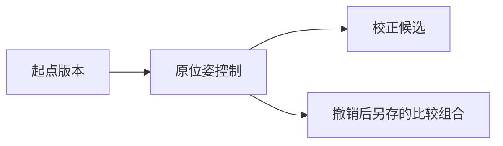

# 工程结果版本与撤销重做

2026-10-23。工程可以保存**当前选中的1至3份目录模型及其来源引用**，以后按相同SHA恢复。撤销和重做切换活动结果版本；几何文件、原扫描、位姿和处理任务结果始终保留。算法参数、选点草稿和原帧编辑的全量回滚仍未实现。

## 在网页中使用

1. 打开 `http://127.0.0.1:8877`，选择单一工程，进入“模型”。载入要保留的起始模型，在画布下展开“工程结果版本”。填写新版本名称和本次决定说明，点击“保存当前模型组合为版本”。第一次登记建立起点，本身没有可撤销的前一版本。
2. 按原有流程核验对应点、明确原帧、运行两组重融合。任务完成后点击“在工程中查看两组结果”，工作区会显示两份结果，活动版本仍保留。
3. 在模型列表明确勾选要保留的结果或组合，再填写名称和决定，保存新版本。处理任务不会自动把校正候选认定为主结果；保存版本也不证明几何更准确。
4. 点击“撤销版本切换”返回前一活动结果，“重做版本切换”前进。也可在版本下拉框选择一个已有版本，点击“切换到此版本”。版本详情保留父版本、决定和已完成重融合的任务来源。
5. 在撤销之后保存新版本会保留原分支，同时清空重做栈。旧候选仍在下拉框中，可以明确切回，不删除旧文件。

临时勾选、局部查看和本地PLY浏览不会自动创建版本。切换项目或重新打开已登记工程时，工作台按固定SHA恢复其活动模型；同工程目录刷新保留当前目录模型的临时勾选。修改概览点预算只改变显示抽样，仍按活动版本SHA读取。

例如：



D仍然保留。撤销/重做记录的是实际版本切换顺序；父版本记录新候选从哪个活动版本另存，二者用途不同。

## 数据和版本检查

每份版本记录工程索引SHA、模型路径与完整文件SHA、名称、决定和来源引用。对已完成的网页重融合结果，还核对工作流当时记录的输出SHA，保留原位姿/校正组身份、核验记录、绑定、计划和结果摘要的固定版本。不会把后来被替换的PLY重新当成那次任务的原输出。

浏览版本时检查这些固定引用，**不会重新解码旧融合计划引用的全部原始深度**。没有工作流来源的目录模型按模型快照登记，本步骤不推断原帧归属。完整原帧重新融合仍由原有核验链负责。

文件缺失、内容变化、索引换版、来源摘要变化或不在当前工程目录中的版本会显示不可用，并阻止切换。可以先核对文件或查看其他仍可用版本；程序不改写历史SHA让错误文件通过。

版本状态位于 `reports/web-studio/project-history/<扫描ID摘要>/state.json`。更新使用预期状态SHA，防止旧页面覆盖新操作；同一存储目录使用OS文件锁，并通过原子替换写入JSON。进程退出会释放锁，不需要自动删除可能属于其他进程的锁标记。已有版本、父关系和操作记录保留；写入失败保持上一个有效状态。

服务重启后读取相同状态。迁移时通过已有路径映射解析旧绝对路径，读取不改写历史记录原字节。两台电脑若使用独立checkout，Git同步代码不会同步忽略目录中的工程版本；完整reports和对应模型/来源文件需要一起迁移。本机路径配置仍保持各自独立。

当前只登记同一工程中的毫米目录模型。跨工程组合、浏览器临时PLY、算法运行中的可变状态，以及选点/帧筛选草稿不在此版本范围内。没有连接语言模型或扫描设备。

## 接口和复查

- `GET /api/history?scan=<ID>`：当前索引、状态SHA、版本及可用性、活动版本、撤销/重做状态和操作事件。
- `POST /api/history`：`action`为 `save`、`restore`、`undo`、`redo`；带当前 `scan_id`、`index_sha256`、`state_sha256`。save还要提供目录模型ID与已加载SHA、版本名称及决定说明。
- `GET /api/cloud` / `GET /api/region`：可带 `sha256`，源文件或回复与固定版本不一致时拒绝加载；前端的预算切换也保留这个约束。

启动服务后可以运行真实接口验收。它复用已完成的114帧重融合任务，添加四个清楚标记为“接口验证”的版本，执行撤销、重做和分支，再恢复运行前的活动版本；若此前没有版本，就停留在新登记的原工程基线。需要本机已有原研究结果，输出目录必须是新的。

```powershell
.\.venv\Scripts\python.exe scripts/check_project_history_live.py --port 8877 --out reports/new-project-history-check
```

本轮初次真实HTTP创建四个版本并完成八次操作，共享查看器CPU显示两组9,657/9,682个原顶点。随后最终服务重启，原状态SHA完全一致，四版本仍可用，按固定SHA预览通过，未重复添加版本。189项Python测试与六项Node检查通过，包含跨进程文件锁、双服务并发、写入失败、历史损坏和旧异步回复。初次创建和最终读回的代码SHA分别记录；本轮未新增真实Chrome/GPU操作，也没有重新融合或修好整份失败扫描。[精简证据](../research/verification/2026-10-23-project-history/README.md)。

2026-10-24补充：[未完成选点草稿](landmark-drafts.md)已作为独立快照接入对应点页；不改变这里工程结果版本的范围。
