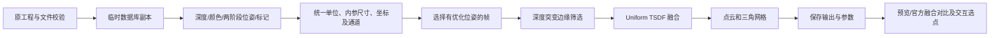

# 2026-10-18 新扫描工程：解包、彩色重建与转台研究

整理日期：2026-10-19。所有结果来自本机保存的工程与当前代码实跑，主线为离线后处理。

最直接的入口是 [研究首页](../reports/range2-study-20261018/index.html)，其中包含逐工程表格、完整 PLY、参数和诊断链接。可以打开 [26 份三维结果](../reports/range2-study-20261018/review.html)、[原预览的三色对比](../reports/range2-study-20261018/comparison/comparison.html) 和 [官方保存融合对比](../reports/range2-study-20261018/official-fusion-comparison/comparison.html)。

## 1. 本次拿到了什么

原件目录：`C:\Users\5gvs4\AppData\Roaming\Revopoint\RevoScan6\Projects`。只读访问原件；临时恢复数据库头和所有计算均在副本或本项目输出目录中进行。

| 内容 | 实测数量 | 含义 |
| --- | ---: | --- |
| 20261018 开头的工程 | 29 | 26 份有深度，3 份为空工程或测试工程 |
| 保存深度帧 | 9,434 | 全部解码，格式错误 0 |
| 原保存位姿 | 9,434 | 与深度按完整帧 ID 关联 |
| 优化表位姿 | 9,352 | 82 帧没有这个阶段的位姿，仍保留原位姿和深度 |
| 有效深度观测 | 266,838,143 | 跨帧累计，包含同一表面的重复观测 |
| 带对齐颜色的帧 | 4,719 | 与有效深度一一对应的颜色数组 |
| 原始 JPEG | 4,719 | 原样保留；容器和图像结构检查通过 |
| 标记观测 | 41,974 | 12 份标记工程内的逐帧观测次数，不是独立标记个数 |
| 单工程 TSDF | 26 | 共融合 9,352 帧有优化位姿的深度，未做跨工程组合 |

清点时原件约 3.03 GB，共记录 388 个文件的 SHA256。逐工程解包前后核对原件，最终核对另存 [source-integrity.json](../reports/range2-study-20261018/source-integrity.json)。原始工程的无深度示例 `Project_Example` 未计入上表。

用户说明主要使用 RANGE 2，扫描基本使用转台，当前手边设备是 Inspire。文件中出现两组设备指纹和标定组合；报告不公开设备序列号，也不靠指纹猜测每份工程的具体型号。输入包含杯子、人偶、弯曲物体等，不能将 26 份自动视为同一个物体合并。

**“全部解码”只指实际保存在文件内的记录。** 文件无法证明官方软件在保存前没有做筛选、丢帧、跟踪重启或其他处理。保存位姿和优化位姿来自厂商，尚未自行实现扫描跟踪。

## 2. 新旧工程的数据结构不同

这里的 `6.1` 是 `.revox` 工程清单的 `version`，不据此确定安装程序的完整发行版本。我们没有把实测字段当成官方公开接口。

| 项目 | 旧四份工程 | 本次新扫描 |
| --- | --- | --- |
| 深度表 | `FrameRGBD` | `Frame_Attr_rgbd` |
| 位姿表 | `FrameInfo.bin` | `Frame_Attr_pose` |
| 额外优化位姿 | `global_register_pose.pose` | `table_pose_optimized` |
| 深度头 | 16 字节 | 20 字节 |
| 典型深度尺寸 | 400×300 | 800×600 |
| 紧凑位姿 | 164 字节，矩阵从偏移 16 开始 | 132 字节，矩阵从偏移 4 开始 |
| 光学坐标到位姿输入坐标 | `[1,-1,-1]` | `[1,1,1]` |
| 颜色解释 | 按旧格式处理 | 有效深度后附 `A,B,G,R` 字节，输出为 `R,G,B,A` |

因此，旧解析器不能不加区分地处理新工程；也不能根据“同属 Revopoint”就沿用 Y/Z 反转。

### 2.1 深度 BLOB

```text
偏移 0..19：5 个 little-endian uint32
  width, height, 有效深度数量, 布局码, 未解释字段（本批为 0）

偏移 20 开始：有效位图
  每像素 1 bit，低位优先，逐行排列
  800×600 像素 -> 60,000 字节位图

随后：count 个 little-endian float32 深度，单位 mm

彩色布局随后：count×4 个字节
  每个有效深度对应 A、B、G、R
```

本批布局码为 `0x10000`（无颜色）或 `0x10001`（带颜色）。程序严格检查总字节数、位图的 1 数量、无效尾位及深度范围，遇到未知格式明确报错并保留字节，不尝试猜字段。

恢复时建立全零二维数组，按位图 1 的顺序填入深度。颜色数组保持与有效深度相同的顺序；无深度的位置不会生成三维点。`depth_scale=0.005` 等清单字段没有再次乘到已经是毫米的浮点值上。

### 2.2 位姿、内参与坐标

位姿 BLOB 是 `uint32(1)` 后接 16 个 `float64`，组成 4×4 刚体矩阵。程序检查旋转与齐次矩阵是否合法。原位姿和优化位姿分别保存，不互相覆盖。

`param/Pl.bin` 保存深度内参；标定尺寸有 800×600 和 1600×1200 两种，投影时按真实深度尺寸缩放焦距、主点，不能只读矩阵数字而忽略尺寸。

对深度像素 `(u,v)`：

```text
Z = depth[v,u]
X = (u - cx) × Z / fx
Y = (v - cy) × Z / fy

本批：point_scan = pose × [X,Y,Z,1]
旧四份：point_scan = pose × [X,-Y,-Z,1]
```

新约定通过两类证据核实：代表工程与原预览的几何位置一致；41,974 次局部标记经过位姿转换后与保存的全局框架一致。错误反转会产生明显的几百毫米级错位。证据见 [coordinate-probe.json](../reports/range2-study-20261018/coordinate-probe.json) 和 [标记分析](../reports/range2-study-20261018/marker-analysis/summary.json)。

这些是扫描参考系中的相对位姿。转台上物体旋转时，文件里的“相机轨迹”可能表示相机相对物体的运动，不能把它直接当成相机在房间里的真实移动。

### 2.3 颜色：物理含义与数组一致性要分别核实

原 JPEG 容器是 12 字节头加 JPEG 原始负载，常见图像为 1600×1200。`Prgb.bin` 与 `LC_RT.bin` 提供颜色相机内参及从深度相机到颜色相机的变换。将深度点投到 JPEG 后，字节顺序 `[1,2,3]` 与 Pillow 的标准 RGB 解码高度一致，代表样本的通道平均绝对误差中位数约为 0.333/255。

**这个结果只能证明两种保存数据的数值对应，不能证明它们的 R/B 物理含义正确。** 放大人偶蝴蝶结可见，JPEG 按常规 RGB 解码显示红色，官方预览与保存融合 PLY 显示蓝色。用户确认实物“蝴蝶结蓝色”，因此最终解释应为：

```text
深度附带字节 [A,B,G,R] -> 解包颜色 [R,G,B,A]
JPEG 原件不改；需要显示真实颜色时，对标准解码数组交换 R/B
```

初期按 JPEG 一致性选定的颜色方向已更正。4,719 个彩色缓存更新到 `color_layout_version=2`，逐帧检查深度数组完全不变，彩色 TSDF 重新计算。缓存迁移记录见 [color-cache-correction.json](../reports/range2-study-20261018/color-cache-correction.json)。修正前的 `color-marker-probe.json`、`color-native-preview-audit.json` 保留为调查记录，最终结论以 [color-validation.json](../reports/range2-study-20261018/color-validation.json) 为准。

此结论适用于已验证的这批格式与样本，不预设未来所有固件、型号及工程格式的通道顺序相同。原始 JPEG 保持原字节，方便后续重新核对。

### 2.4 标记点

局部标记头为版本 `2`、记录数量，每条 36 字节；前三个 float32 是局部 XYZ，随后三个数看起来是单位方向，剩余 12 字节不赋予含义。全局框架头为版本 `3`、记录数量，每条 104 字节；前三个 float64 是扫描参考系 XYZ，后三个是方向候选，其余 56 字节原样保留。

逐帧标记经位姿转换后，对保存框架作最近邻残差分析。多数工程的中位残差约 0.02–0.09 mm，存在很大的尾部异常。这是同一软件内部的数据一致性，不能用它宣称设备达到了这个物理精度。最近邻框架索引也不是已经解码出的稳定标记 ID。

数据库框架与 `marker_framework.mkf` 大多相同；13:05:40 有差异，两套均保留。另做了 0.5 mm 阈值的平面试探，主平面只解释约 39%–81% 标记，不能直接把所有标记视为同一桌面并据此自动删掉背景。

追加检查了全部 41,974 条局部记录的尾部：偏移 24 的数按 float32 解释约为 0.254–0.811；偏移 28 仅有 1.5 和 3 两种值；偏移 32 全为零。367 条保存框架记录的尾部也有许多常量字节。目前没有据此建立稳定的标记身份，仍不把这些值命名为半径、质量或 ID。分布证据见 [marker-opaque-fields.json](../reports/range2-study-20261018/marker-opaque-fields.json)。

### 2.5 帧元数据：哪些看起来像状态，哪些还不能直接使用

继续检查全部 9,434 条 `Frame_Attr_info`：每条 75 字节，只有偏移 4、10–11、15–18、32 的字节在本批记录间变化。当前只按偏移记录字段，不赋予厂商未公开的语义。

| 观察字段 | 本批事实 | 当前用途 |
| --- | --- | --- |
| `u32@10` | 多数像递增序号，但会重置、跳号、倒退 | 诊断分组边界，不能当时间戳 |
| `byte@4` | 84 条为 0，其中 82 条缺优化位姿、2 条仍有 | 不能作为自动删帧标志 |
| `byte@32` | 本批为 1 的 3,380 条均有标记属性；为 0 的均没有 | 仅记录对应关系，未确认为通用模式码 |
| `f32@15` | 无标记工程中多为有限正数；标记工程中为 0 | 不命名为质量、置信度或尺度 |

13:13:59 的两组 `u32@10` 范围分别为 1–222、289–426，实际保存 358 条，数值范围中有 68 个未出现值。但这不能证明设备在那些位置输出过可恢复的物理帧，也不能确定是软件筛选、重新跟踪还是其他原因。10:49:20 中 ID=1 的这个字段为 194，ID=2 又回到 3，更说明它不是可靠的全项目时间轴。

9,352 对保存位姿/优化表位姿中，8,790 对逐元素完全相同，562 对不同；不同项都在人偶 12:26:07 中。优化表存在不等于每份扫描都经历了可见的位姿调整，也不等于这些位姿一定正确。不能由矩阵相同推断软件内部完全未处理。

属性注册表 `TableAttributes` 中出现 `depth_weight`、特征等名称，不等于相应逐帧数据实际保存在文件中；本批已见的数据表仍以上述解包结果为准。完整逐帧字段与异常步长保存在 [帧信息调查](../reports/range2-study-20261018/frame-metadata/README.md)。

## 3. 怎样从这些数据生成当前结果



基线使用有优化表位姿的帧；深度仍是原工程保存的测量，不由原预览或官方融合云反推。相邻有效像素深度相差超过 3 mm 的两侧边缘暂不参与融合，减少跨轮廓拉桥。缺失像素不会填成零深度表面。

TSDF 内部使用米，导出点云和网格使用毫米。26 份基线请求体素为 0.6 mm；本机 Windows Open3D 的旧 Scalable TSDF 未通过已知平面控制，因此基线使用有界的 Uniform TSDF，分辨率上限为 256³。场景大时会自动增大实际体素；本批实际约 0.597–2.463 mm。人偶 12:26:07 的实际体素约 0.938 mm。截断距离取 `max(请求值,4×实际体素)`。后续已测通另一种 CPU Tensor 稀疏后端，可固定 0.4 mm，见 5.5 节；默认基线尚未替换。

**不能把命令中的 0.6 mm 当成所有输出的实际精度或分辨率。** 含大量桌面、漂移和远处碎片的场景会拉大包围盒，也会降低物体区域的有效分辨率；这正是后续应优先做物体区域选择的原因。

每份输出：

```text
reconstruction/scan_时间/
  tsdf_pointcloud_mm.ply  表面点云，彩色帧参与时含颜色
  tsdf_mesh_mm.ply        三角网格，含顶点色
  tsdf_mesh_mm.obj        几何网格，不含本次顶点色/纹理
  reconstruction.json    输入索引哈希、帧选择、体素、截断、计数和质量指标
```

当前表面没有做封闭补洞，没有证明水密或适合直接打印。也没有把不同工程强行拼成一个物体。26 份有深度的工程均生成非空结果，表示管线可运行，不表示 26 次扫描都成功。

## 4. 与官方结果的比较能说明什么

### 4.1 保存融合点云：12:26:07

工程清单 `point_clouds` 中有带 `fuse_param` 的 `Fused 1018_1 (0.40mm).ply`，共 533,469 点，模型对齐旋转和平移均为零。可与本工程自己的 TSDF 在同一坐标下直接比较，没有额外 ICP 或缩放。

先按共同固定原点的 0.5 mm 体素取代表点，再双向查最近邻；容差为 1 mm 时：

| 指标 | 自研 → 官方融合 | 官方融合 → 自研 |
| --- | ---: | ---: |
| 最近邻距离中位数 | 0.223 mm | 0.383 mm |
| 容差内支持率 | 97.11% | 99.26% |

这说明主体几何与官方保存融合较一致。官方标称融合间距为 0.4 mm，自研实际 TSDF 体素约 0.938 mm，采样和算法并不等价；这些数字不能证明自研比官方更准确。对细节、平滑、孔洞还要在完整模型上局部查看。

### 4.2 其他工程以原预览为参照

26 份工程均有预览对比，绿色表示在对侧容差范围内能找到点，蓝色仅自研支持，橙色仅官方支持。它们是邻域支持关系，不是一一对应，也不是自动的正确/错误标签。

11:56:56、13:12:22、13:13:59 等仍有大量背景、碎片或重影。其最大网格连通分量仅占约 49.7%、38.8%、55.6% 三角面；原预览和自研也差异较大。不能只保留最大分量就认定问题已修复，因为真实物体可能包含多个不相连部分。

对比统计使用完整分析云；页面显示每侧约 1–2 万点的确定性抽样。点击点可查看对侧最近支持位置、距离及局部放大。实际顶点颜色与三色分类分开查看，避免把分类色误认为物体色。

## 5. 会影响后续交互设计的实验

### 5.1 转台运动约束：适合做诊断，尚未用于自动纠正

对保存位姿的相对变换，拟合一个固定旋转轴及轴心线，检查旋转与平移偏离程度。若相对运动满足刚性固定轴，平移应接近 `(I-R)c`。沿轴方向的轴心坐标不可观测，因此仅报告最小范数轴心线表示。

本批多份工程符合单轴旋转；某些工程的旋转轴能量占比超过 99.9%。同时仍有原点残差数毫米、局部异常和分段。帧 ID 高 32 位分组仅作分段诊断，不给它臆造“跟踪失败”或“第二次扫描”的确定含义。没有可信采集时间戳，因此图上的帧序号不代表真实匀速时间。

详见逐工程 `turntable-poses/scan_时间/report.json`、CSV 和 `relative_motion.png`。当前不把拟合轴自动写回位姿；轴拟合好也不等于物体表面准确。

### 5.2 标记修正与缺失优化位姿：数值变好不一定重建变好

13:05:40 保存 275 帧，其中 193 帧有优化位姿，另外 82 帧集中在另一个 ID 高位组。主结果融合前 193 条可用优化位姿，全部原记录保留。

尝试对额外帧利用标记框架修正位姿：偶数序号标记拟合，奇数序号标记留出验证；同时限制修正幅度和验证残差。82 帧中有 78 帧通过实验门槛。对照和候选都融合相同 271 帧，避免用“加帧”冒充“位姿改进”。

| 验证项 | 原位姿 | 标记修正后 |
| --- | ---: | ---: |
| 654 个留出标记的残差中位数 | 0.275 mm | 0.103 mm |
| 留出标记残差 P90 | 0.905 mm | 0.204 mm |
| 82,545 个新增深度点到 193 帧基线的距离中位数 | 4.778 mm | 4.795 mm |
| 新增深度点在基线 1 mm 邻域内比例 | 15.119% | 15.123% |

**候选没有改善物体表面的对齐，因此不加入主结果。** 可能存在物体相对转台移动、翻面、分段跟踪等因素；当前证据不足以确定具体原因。基线自身也不是真值，远离它的点可能是新表面或背景，不能单凭距离删掉。

这对课题很有价值：标记对齐、相机运动一致性与物体表面对齐是不同层面的证据。Agent 应分别显示证据、生成候选并提供撤销，不应只因为某个残差降低就自动合并。

### 5.3 物体区域选择：直接改善背景占用和融合分辨率

针对 13:12:22、13:13:59 两份失败杯子扫描，用已核对的颜色提出一个空间盒：绿色种子满足 `G-R>3、G-B>8、G>12`；每帧每 8 个种子抽一个投到原扫描参考系，按各轴 0.5%/99.5% 分位数取范围，再向每侧扩 6 mm。最终保留盒内**全部颜色**的深度，避免仅保留绿色而丢掉黑色图案和内壁。

整个过程没有使用官方预览或融合几何，没有改任何位姿与参与帧。颜色阈值只适合这批绿色杯子，不是已经通用的分割算法。

| 工程 | 原 / 候选实际体素 | 原 / 候选表面点数 | 原 / 候选主连通面 | 保留原深度像素 |
| --- | --- | --- | --- | --- |
| 13:12:22 | 2.063 / 0.607 mm | 89,463 / 205,368 | 38.8% / 88.1% | 61.9% |
| 13:13:59 | 2.186 / 0.598 mm | 38,247 / 202,203 | 55.6% / 95.0% | 94.4% |

背景排除与更细的实际体素共同改变了结果，不能把全部变化归因于“修好了跟踪”。仍有碎片、孔洞或错误几何；选区也可能误裁真实部分，须人工检查。它给课题提供了一个具体交互入口：用户圈物体或选颜色种子，软件预览保留/排除的数据，确认后重新融合。见 [选区实验与三维对照](../reports/range2-study-20261018/experiments/cup-roi/README.md)。

### 5.4 用原深度区分“没看到”与“存在冲突”

以 13:10:19 杯子表面为参考，对 13:11:27、两份裁剪候选作 PCA/FPFH 粗配准与多尺度稳健 ICP。三份都没有通过原先的完整重叠门槛；没有自动加入主组合。几何门槛拒绝只代表暂不能自动放行，不足以证明是不同物体或所有差异都是错误。

进一步将对齐后的点投回参考工程保存的深度图。对每个投影位置比较：

```text
保存深度 ≈ 点的相机 Z：观测支持
保存深度 < 点的相机 Z：点可能被前方表面遮住，不算冲突
保存深度 > 点的相机 Z：该点挡在已观察表面前，可能存在空域冲突
没有有效深度 / 超出视野：没有证据，不当成错误
```

使用经过 3 mm 突变边缘筛选的深度；每组抽样 20,000 个表面点，对参考工程每 8 帧抽一个并保留末帧，共 27 视图。2 mm 容差下，至少两次支持与至少三次冲突分别计数，并保留“支持与冲突并存”的类别：

| 来源 | 至少两视图支持 | 至少三视图冲突 |
| --- | ---: | ---: |
| 参考 TSDF 对自身保存深度 | 96.5% | 0% |
| 13:11 对齐候选 | 72.7% | 3.2% |
| 13:12 裁剪后候选 | 33.2% | 22.6% |
| 13:13 裁剪后候选 | 59.2% | 18.5% |

遮挡和有效投影次数都另存，支持与冲突比例不要求相加为 100%。阈值放到 4 mm 后，13:11 冲突比例为 0.42%，两份失败扫描仍约 20.1% 和 14.5%，差异并非只体现在最近邻覆盖。

再反过来用 13:11 的 33 个保存视图检查 13:10，2 mm 时参考表面冲突 2.43%，而 13:11 自身控制已有 3.06%；4 mm 时分别为 0.225% 和 0.055%。这说明保存数据自身也存在阈值敏感的偏差，不能把任意冲突直接判成某一个来源错误。

13:10 与翻面 13:11 的一部分低重叠可能来自互补可见区域，因此另存一个 **138,885 点的两表面组合探索候选**，只供人工检查，没有推翻原门槛、没有纳入主结果。它是已重建表面点的体素整合，不是多工程原深度再次 TSDF。见 [候选三维审阅](../reports/range2-study-20261018/experiments/cup-complementarity/review.html)、[原深度证据着色](../reports/range2-study-20261018/experiments/cup-visibility/review.html) 和 [配准记录](../reports/range2-study-20261018/experiments/cup-registration/summary.json)。

这些检查仍依赖同源的位姿、深度、标定和估计的跨工程变换，视图间高度相关。计数是可定位的证据，不是概率置信度、独立留出评估或物理精度证明。下一步交互应允许用户查看冲突区域、选择互补表面、修正初始对应，再比较候选。

### 5.5 固定分辨率的稀疏融合后端

在本机对旧 ScalableTSDF 做了 16 组平面控制，变化深度类型、采样步长、块大小和体素后仍输出空表面，不能直接用它替换当前基线。但进一步按 [Open3D Voxel Block Grid 官方说明](https://www.open3d.org/docs/latest/tutorial/t_reconstruction_system/voxel_block_grid.html) 测试 CPU Tensor 后端，平面尺寸、颜色以及观测权重门槛控制均通过。这是另一套实现，不能由旧后端的失败推断它也不可用。

新适配器使用米制浮点深度、归一化浮点 RGB、稀疏 16³ 体素块，固定体素大小；无需按大场景包围盒整体降低分辨率。浮点颜色需归一化，不能把 0–255 直接作为 0–1 使用。对人偶同一 563 帧实跑，截断距离仍保持 3.750457 mm：

| 方案 | 实际体素 | 表面点数 | 自研→官方距离中位数 | 官方→自研中位数 | 1 mm 双向支持 |
| --- | --- | ---: | ---: | ---: | --- |
| 原 Uniform | 0.938 mm | 139,848 | 0.223 mm | 0.383 mm | 97.11% / 99.26% |
| Tensor，权重阈值 0 | 0.400 mm | 793,214 | 0.280 mm | 0.265 mm | 94.81% / 99.21% |
| Tensor，权重阈值 3 | 0.400 mm | 759,776 | 0.275 mm | 0.265 mm | 97.81% / 98.98% |

两种 Tensor 提取使用的活动块均为 5,151 个，其活动体素属性约 422 MB；还存在哈希、预留容量、图像、提取缓冲等内存，不能把这个数字当作进程峰值。运行约一分钟量级只代表本机该样本，不是未来性能保证。

分辨率提高后表面密度和双向支持发生了不同变化；权重门槛减少低观测表面，也可能去掉真实少视角细节。因此没有仅凭点数增加就宣布优于官方。后端、格点位置、提取方式与权重规则也不同，不能将全部差异归因于体素大小。结果非水密，主基线保留。

见 [三方案对官方融合的交互比较](../reports/range2-study-20261018/experiments/tensor-tsdf/comparison.html)、[彩色三维结果](../reports/range2-study-20261018/experiments/tensor-tsdf/review.html) 和 [参数表](../reports/range2-study-20261018/experiments/tensor-tsdf/README.md)。后续可在更多工程上验证该后端，再决定是否设为正式融合默认值。

### 5.6 参与帧选择：多个指标可能给出不同排序

13:13:59 的完整帧 ID 高位有两组，分别含 220 和 138 帧。将两组分别融合，保持原优化位姿、同一空间盒、0.598 mm 实际体素和相同截断距离。没有给 ID 高位赋予“失跟”等未经确认的厂商语义。

| 结果 | 最大连通面比例 | 对参考深度至少两次支持 | 对参考深度至少三次冲突 |
| --- | ---: | ---: | ---: |
| 原两组共同融合的 ROI | 95.0% | 59.2% | 18.5% |
| 组 0，220 帧 | 99.5% | 63.4% | 17.2% |
| 组 1，138 帧 | 96.9% | 65.1% | 9.5% |

每组均抽样 20,000 点，以同一个先前估计的整扫描跨工程变换对参考 27 个深度视图作检查；没有为每组重新优化对齐。因此这些结果只帮助定位不同片段的表现，不能用来保证组 1 更准确。各组视角和表面点集也不同。

这里最大连通面较高的组，并没有同时取得较低的冲突率。软件应让用户检查局部证据、选择参与片段，而不是只按片段长短或单一连通性指标删除。见 [分组三维审阅](../reports/range2-study-20261018/experiments/cup-id-groups/review.html) 与 [保留的帧 ID、指标和局限](../reports/range2-study-20261018/experiments/cup-id-groups/summary.json)。

### 5.7 分段对齐后，使用同一批原深度重新融合

分组图中，杯底和杯口在原坐标中的关系值得进一步检查。将两组各自的自研表面向 13:10 参考表面配准，估计得到的两个刚体校正相差约 178.5°。这是算法候选的差异，不是已确认的物理转角；杯子的对称性、分段坐标关系和未解释字段仍可能影响判断。

随后进行一个更严格的成对实验：两边都使用原 358 帧、原优化位姿、相同原坐标 ROI 像素、0.6 mm Tensor TSDF、2.4 mm 截断和提取权重阈值 3。唯一设计差异是跨段变换：

```text
对照：point_reference = T_whole × M_frame × point_optical
候选：point_reference = T_group × M_frame × point_optical
```

原位姿文件不改，跨段变换单独保存。两边均读入 7,910,368 个有效深度像素，按相同原 ROI 排除 442,401 个像素，再作相同深度边缘处理。不是靠换帧或更细网格来获得较低冲突。

额外对保存的两套位姿覆盖矩阵重新执行原选区公式，逐帧比较选区后深度数组并计算整段 SHA256：358 帧均一致。该核对没有重新融合，记录见 [selection-mask-check.json](../reports/range2-study-20261018/experiments/cup-piecewise-pose/selection-mask-check.json)。

| 指标 | 整扫描统一变换对照 | 两组分别对齐候选 |
| --- | ---: | ---: |
| 表面点数 | 192,983 | 216,744 |
| 20,000 抽样点中至少两视图支持 | 57.82% | 66.80% |
| 至少三视图深度冲突 | 20.12% | 9.72% |
| 主连通面比例 | 97.10% | 92.11% |

冲突减少，表面支持增加，但连通性退步，残余问题仍明显。两个分组单独配准也没有通过原先完整重叠门槛，因此候选没有纳入主结果。参考表面参与了变换拟合，它的原深度又参与检查，**这不是独立留出或真实精度验证**。同一组内的漂移，也不能靠组间刚体变换完全修复。

这提供了一个可以落地的辅助重建工作流：拆分片段 → 给出多个刚体对齐候选 → 保持原像素与融合参数做对照 → 用户检查支持、冲突与连通性，再决定采用哪个区域。见 [重新融合的三维对照](../reports/range2-study-20261018/experiments/cup-piecewise-pose/review.html) 与 [完整矩阵和同输入核对](../reports/range2-study-20261018/experiments/cup-piecewise-pose/summary.json)。

### 5.8 换一份扫描检查，并固定相同的原始深度像素

前一节比较的是重新融合后各自抽取的表面点。为避免融合筛选和表面采样掩盖问题，追加固定原帧、原像素的检查：358 帧各取 64 个原 ROI 内且经过相同边缘筛选的点，共 22,912 个。整段与分组变换作用于完全相同的点，不重新配准、不重新融合。

13:10:19 是已有拟合参考；13:11:27 没有参与两组变换拟合，其到参考的既有配准保持固定。后者此前已被查看，因此只能称为额外扫描检查，不能称为预先注册的盲测。毫米阈值保持原先的 2、4 两档。这几份绿色杯子按同物体候选研究，物理身份尚未独立确认，差异也可能来自物体本身。

| 深度检查来源 | 阈值 | 至少两视图支持：整段→分组 | 至少三视图冲突：整段→分组 |
| --- | --- | --- | --- |
| 拟合参考 13:10:19 | 2 mm | 64.1% → 60.7% | 28.0% → 5.0% |
| 拟合参考 13:10:19 | 4 mm | 67.4% → 61.4% | 24.3% → 3.2% |
| 额外扫描 13:11:27 | 2 mm | 25.1% → 64.5% | 24.8% → 33.1% |
| 额外扫描 13:11:27 | 4 mm | 34.1% → 73.5% | 20.3% → 13.2% |

**这给出了之前单一参考没有揭示的限制。** 分组候选在另一份扫描上获得更多支持，但 2 mm 下重复冲突增加；4 mm 下冲突才减少。不能只挑较好的阈值来宣布成功。

还比较了两边都至少三次投影到有效深度的相同点，避免移出视野造成假改善。原参考有 22,476 个共同可观测点，其中 4,453 个从“重复冲突且支持不足”变成“未定”；这些点中 4,437 个调整后至少三次被前方表面遮挡。**冲突消失不等于获得表面支持。** 遮挡是合理的观测情况，但本身不能确认候选位置正确。

额外的内部对照排除了源帧及前后 8 条已存记录，再用自己的深度检查自己的原始点：13:10:19 在 2 mm 下约 0.04% 有重复冲突；13:11:27 约 8.52%，4 mm 下约 0.63%。这说明第二份扫描自身也有不一致，不能视作无误差的真值。内部一致也不代表物理准确；不同样本与区域权重不能直接作设备精度排名。

本轮继续保留候选，主结果不变。软件应同时显示支持、冲突、遮挡、未定及阈值变化，让用户检查杯口、杯底、杯柄等明确区域，而不是依赖单个总分自动接受。见 [同像素交叉检查与静态图](../reports/range2-study-20261018/experiments/cup-piecewise-crosscheck/README.md)、[三维证据着色](../reports/range2-study-20261018/experiments/cup-piecewise-crosscheck/review.html) 和 [深度重复观测对照](../reports/range2-study-20261018/experiments/cup-depth-repeatability/README.md)。

### 5.9 直接片段配准与分块留出

改为直接把同一扫描的组 1 对齐到组 0，不借助其他扫描的参考几何。按每组索引顺序以 16 条记录分块：186 帧训练、172 帧留出，交集为零。原 ROI 此前使用过全部帧，所以不是完全盲测。

训练阶段单独融合两片段，保留多个位置不同的配准候选。训练几何最佳估计约 179.18° 刚体旋转；该角度是算法候选，不代表已解码的实际翻面操作。固定 11,008 个留出原像素，以另一组的留出深度检查：

| 候选 | 2 mm 支持 | 2 mm 冲突 | 4 mm 支持 | 4 mm 冲突 |
| --- | ---: | ---: | ---: | ---: |
| 原保存片段关系 | 41.97% | 28.07% | 50.12% | 23.83% |
| 训练几何最佳 | 49.69% | 0.37% | 51.69% | 0.32% |
| 几何备选 1 | 55.40% | 2.44% | 66.41% | 1.38% |

训练最佳由训练数据预先选定，没有用留出分数重新换胜者。仍有大量未定或遮挡点，严格完整重叠门槛未通过，不自动采用。颜色精修使两个初值收敛到近似同解，但 2 mm 留出支持没有超过原训练几何最佳；它是在查看留出结果后追加的探索。

随后用四个冻结候选各自重新融合全部 358 帧，逐数组核对原 ROI 深度 SHA256 相同。重复杯柄轮廓减少，但孔洞、碎片仍在，主连通面比例反而从约 99.3% 降至约 89%–90%，说明连通性不能单独排名修复质量。详见 [完整研究与可复现脚本](../reports/range2-study-20261018/experiments/cup-direct-split/README.md)。

### 5.10 对应点交互原型

新增独立 HTML 工作台：固定片段、移动片段、对齐叠加三栏；用户选择三对以上同一物理位置，计算刚体变换，检查每对残差，导出原顶点编号和矩阵。修改选点后会使旧手工结果失效，避免导出不匹配的旧矩阵。

Python 后端核对原文件哈希、原顶点编号和预览舍入，以原始坐标重新求解，再另存对齐结果；可选 ICP 也单独保留。该输出可以直接接回相同原像素的全帧融合程序。数值经 80 组 Python SVD/浏览器四元数交叉检查，另有模拟交互和合成端到端验证；真实已有候选的自动回放输出逐字节一致，没有伪造人工选点。实际 GPU 画面仍待验证。见 [使用方法](landmark-workbench.md)。

### 5.11 覆盖、原帧回查与离线补扫方向

在直接训练最佳的全帧模型上抽取 40,000 点，回投全部 358 个保存深度视图。分别保存支持、冲突、遮挡、分组支持、支持帧位图和观察方向分布。约 16.9% 的点至少三帧支持，但相对首支持方向最大夹角仍小于 15°。这些是同源内部指标，不是独立精度结果。

一个杯内壁附近的代表点有 27 帧支持，最大首视角夹角仅 9.77°。已回查具体帧 ID、深度像素和对齐颜色，并展示另一方向被杯壁遮挡的例子。由此可以让用户查看异常点的原始证据，后续 Agent 也可引用同一结构化记录。

进一步对六个已观察弱区域尝试新的观察方向，并用当前网格射线检查，保留五个建议；一个区域因遮挡未给建议。建议只在物体参考系中，不是房间轨迹或设备指令，也不推断完全未观察到的形状。重复冲突区先检查配准，不直接要求补扫。见 [完整说明与命令](offline-coverage-guidance.md)。

### 5.12 失败工程序列诊断与未采用的方法

13:12:22 的相邻记录有 7 对在可比较像素中出现至少 20% 的 2 mm 自由空间冲突；索引间隔 8、32 时分别有 82、97 对。两个较稳定杯子对照没有达到同一门槛的记录对。记录索引不是时间，这些分歧只能提出审阅位置，不能指出哪一帧错误。[完整序列诊断](../reports/range2-study-20261018/experiments/depth-sequence-consistency/README.md)保留双向检查与具体帧号。

用训练位姿拟合理想固定转轴，再检查留出深度，失败工程的冲突反而增加，因此没有采用。[转轴实验](../reports/range2-study-20261018/experiments/fixed-axis-depth-prior/README.md)说明“轨迹更规则”不等于“表面对齐更好”。

按上述分歧拆为 8 段后，段内保存位姿固定，只估计段间刚体关系。7 条相邻几何连接仅 3 条通过当前启发式门槛，程序停止，没有全局位姿图优化或新的融合模型。后续颜色 ICP 没有救回失败连接，但发现 4→3 的原始关系已通过同一门槛，自动调整反而变差。见[分段记录和对应点工作台](../reports/range2-study-20261018/experiments/cup-segment-pose-graph/README.md)与[颜色实验](../reports/range2-study-20261018/experiments/cup-segment-color-edges/README.md)。分段依据看过全序列，不能把此研究称为盲测。

### 5.13 两工程原始深度联合融合

13:10:19 的 208 帧与 13:11:27 的 255 帧已直接进入同一个稀疏 TSDF。三组对照是第一份单独、第二份按冻结变换单独，以及联合 463 帧。每来源的清理后深度、物理 RGB 与最终相机位姿有序 SHA256 完全相同，参数均为 0.6 mm 体素、2.4 mm 截断、3 mm 边缘过滤和提取权重阈值 3。

| 对照 | 表面点数 | 主连通面 |
| --- | ---: | ---: |
| 第一份 208 帧 | 158,101 | 99.98% |
| 第二份 255 帧，对齐后 | 132,272 | 99.66% |
| 联合 463 帧 | 190,388 | 99.81% |

联合表面抽样 40,000 点：52.35% 得到双方各至少两次 2 mm 深度支持，31.97% 仅第一份支持，15.49% 仅第二份支持。12.77% 另有重复自由空间冲突，支持与冲突可能同时出现。第一份单独表面仅 30/158,101 点距联合表面超过 2 mm；联合表面有 28,387 点距第一份表面超过 2 mm，表示范围增加，但不是精度证明。

已把补充杯底的代表点回查到原帧：第一份没有支持、186 次遮挡；第二份有 86 次支持、没有冲突。另一个杯口附近代表点在双方都有支持，但第二份有 18 次冲突。详见[联合融合、来源着色与原帧证据](../reports/range2-study-20261018/experiments/cup-multi-scan-tsdf/README.md)。

这次沿用先前工程间变换，该变换尚未通过原完整重叠门槛，物体身份也未独立确认；全部深度参与过重建或配准，因此结果仍为探索候选。没有覆盖主基线。新增复合帧标识 `(scan_id, frame_id)`，不把不同工程的同名帧混为同一测量，也不编造采集时间。

另做了[像素邻域敏感性检查](../reports/range2-study-20261018/experiments/cup-multi-scan-tsdf/pixel-sensitivity/README.md)：5,109 个原重复冲突点中，1,694 个在至少三视图的 3×3 有效邻域仍全部冲突。这表明相当一部分单像素判断对附近射线敏感；邻域代表不同物理射线，不能把未满足条件的点宣称为正确，也没有据此删除测量或改动重建。

另以实测深度 3×3 局部点云拟合平面，原 5,109 个轴向重复冲突点中，1,138 个还在至少三个合格平面上显示超过 2 mm 的正法向距离。[局部表面距离报告](../reports/range2-study-20261018/experiments/cup-multi-scan-tsdf/local-plane-evidence/README.md)分别保存小法向差、较大法向差及不合格平面；小平面距离不能排除切向错位。

### 5.14 确定性工具与任务执行原型

已注册六类实际工具，保存配方、输入版本、每步状态、日志和产物哈希。真实数据的五步证据链全部完成，使用 1,000 点抽样核对依赖传递；与完整 40,000 点研究分别记录。当前没有连接语言模型，统一编辑器仍待实现。见[实际运行审阅](../reports/range2-study-20261018/workflow-prototype-run/index.html)与[使用方法](offline-workflow-runner.md)。

## 6. 已形成的解包接口

```text
decoded/scan_时间/
  index.json                         索引、内参、坐标/颜色约定、原件哈希、统计
  poses.csv                          两种位姿分阶段保存
  frame_完整ID/
    frame.npz                        depth_mm[H,W]、rgba[N,4]、color_layout_version
    pose_stored.npy                  [4,4]，平移 mm
    pose_optimized.npy               [4,4]，存在时才生成
    rgb_original.jpg                 原字节 JPEG，未经改色
    frame_info_attribute.bin         未解释的帧信息原件
    frame_pose*_attribute.bin        位姿原字节
    marker_attribute.bin             局部标记原字节，存在时保存
    markers.npz                      XYZ、方向候选、全部原始记录
    frame.json                       各解析阶段状态及数据计数
  global_markers_1.bin / .npz         保存的全局框架
  marker_framework_original.mkf       独立保留的框架文件
```

`N` 是这一帧的有效深度数量，不是 H×W。不要用数组下标代替原帧 ID，也不要将缺少优化位姿解释为已知无效帧。没有可信时间戳时保持 `None`。未来回放可以按索引顺序（本批为完整帧 ID 升序）播放，但不能把它称为真实采集时间线，也不能把人为播放速度称为实际采集帧率。

## 7. 运行方法

在项目根目录 PowerShell 运行。下面使用新的输出目录，避免覆盖当前研究结果；解包输出必须是空目录。

```powershell
$env:PYTHONIOENCODING = 'utf-8'
$study = 'reports\range2-reproduce'

& '.\.venv\Scripts\python.exe' -u scripts\decode_attribute_projects.py `
  --input 'C:\Users\5gvs4\AppData\Roaming\Revopoint\RevoScan6\Projects' `
  --prefix 20261018 --out "$study\decoded"

& '.\.venv\Scripts\python.exe' -u scripts\run_reconstruction_batch.py `
  --decoded "$study\decoded" --out "$study\reconstruction" --pose-policy optimized

& '.\.venv\Scripts\python.exe' scripts\analyze_turntable_poses.py `
  --decoded "$study\decoded" --out "$study\turntable-poses" --split-id-high-word

& '.\.venv\Scripts\python.exe' scripts\analyze_attribute_markers.py `
  --decoded "$study\decoded" --out "$study\marker-analysis"

& '.\.venv\Scripts\python.exe' scripts\compare_project_previews.py `
  --decoded "$study\decoded" --reconstruction "$study\reconstruction" --out "$study\comparison"

& '.\.venv\Scripts\python.exe' scripts\compare_project_previews.py `
  --decoded "$study\decoded" --reconstruction "$study\reconstruction" `
  --reference-kind saved-fusion --out "$study\official-fusion-comparison"

& '.\.venv\Scripts\python.exe' scripts\build_fusion_comparison.py `
  --data "$study\comparison\comparison-data.json" --out "$study\comparison\comparison.html"

& '.\.venv\Scripts\python.exe' scripts\build_fusion_comparison.py `
  --data "$study\official-fusion-comparison\comparison-data.json" `
  --out "$study\official-fusion-comparison\comparison.html"

# 本批数据专用的首页、静态图和三维结果页生成器
& '.\.venv\Scripts\python.exe' scripts\build_attribute_study_report.py --root $study

& '.\.venv\Scripts\python.exe' scripts\verify_attribute_study_sources.py `
  --decoded "$study\decoded" --out "$study\source-integrity.json"
```

转台脚本实际参数名为 `--decoded`，位姿默认 `auto`，会优先选择可用优化位姿。`run_reconstruction_batch.py --skip-existing` 只复用输入索引哈希、参数和输出齐全的任务；输入改变会明确拒绝复用。

补帧实验使用独立空目录：

```powershell
& '.\.venv\Scripts\python.exe' scripts\refine_missing_optimized_poses.py `
  --scan "$study\decoded\scan_20261018130540" `
  --baseline-cloud "$study\reconstruction\scan_20261018130540\tsdf_pointcloud_mm.ply" `
  --out "$study\experiments\marker-recovery" --reconstruct
```

杯子区域、跨工程配准与深度证据实验可按以下顺序另存到新目录：

```powershell
& '.\.venv\Scripts\python.exe' scripts\experiment_color_seeded_roi.py `
  --decoded "$study\decoded" --baseline "$study\reconstruction" --out "$study\experiments\cup-roi"
& '.\.venv\Scripts\python.exe' scripts\experiment_cup_registration.py `
  --study $study --out "$study\experiments\cup-registration"
& '.\.venv\Scripts\python.exe' scripts\experiment_cross_scan_visibility.py `
  --study $study --out "$study\experiments\cup-visibility"
& '.\.venv\Scripts\python.exe' scripts\experiment_cup_complementarity.py `
  --study $study --out "$study\experiments\cup-complementarity"
& '.\.venv\Scripts\python.exe' scripts\experiment_id_group_selection.py `
  --study $study --out "$study\experiments\cup-id-groups"
& '.\.venv\Scripts\python.exe' scripts\experiment_cup_registration.py `
  --study $study --out "$study\experiments\cup-id-registration" `
  --sources "group_0=$study\experiments\cup-id-groups\id_high_0\scan_20261018131359\tsdf_pointcloud_mm.ply" `
            "group_1=$study\experiments\cup-id-groups\id_high_1\scan_20261018131359\tsdf_pointcloud_mm.ply"
& '.\.venv\Scripts\python.exe' scripts\experiment_piecewise_pose_reconstruction.py `
  --study $study --out "$study\experiments\cup-piecewise-pose"
& '.\.venv\Scripts\python.exe' scripts\analyze_attribute_frame_metadata.py `
  --decoded "$study\decoded" --out "$study\frame-metadata"
& '.\.venv\Scripts\python.exe' scripts\analyze_piecewise_holdout.py `
  --study $study --out "$study\experiments\cup-piecewise-crosscheck"
& '.\.venv\Scripts\python.exe' scripts\analyze_depth_repeatability.py `
  --study $study --crosscheck "$study\experiments\cup-piecewise-crosscheck" `
  --out "$study\experiments\cup-depth-repeatability"
& '.\.venv\Scripts\python.exe' scripts\build_piecewise_crosscheck_report.py `
  --crosscheck "$study\experiments\cup-piecewise-crosscheck" `
  --controls "$study\experiments\cup-depth-repeatability"
# 将新实验加入首页
& '.\.venv\Scripts\python.exe' scripts\build_attribute_study_report.py --root $study
```

固定分辨率实验需两个独立输出目录，保留全部 563 帧和相同截断参数：

```powershell
& '.\.venv\Scripts\python.exe' scripts\reconstruct_scans.py `
  --decoded "$study\decoded" --out "$study\experiments\tensor-tsdf\reconstruction" `
  --scans scan_20261018122607 --optimized-only --backend tensor --voxel-mm 0.4 `
  --truncation-mm 3.7504573034925874
& '.\.venv\Scripts\python.exe' scripts\reconstruct_scans.py `
  --decoded "$study\decoded" --out "$study\experiments\tensor-weight3\reconstruction" `
  --scans scan_20261018122607 --optimized-only --backend tensor --voxel-mm 0.4 `
  --truncation-mm 3.7504573034925874 --tsdf-weight-threshold 3
& '.\.venv\Scripts\python.exe' scripts\build_tensor_study_report.py --study $study
& '.\.venv\Scripts\python.exe' scripts\build_attribute_study_report.py --root $study
& '.\.venv\Scripts\python.exe' scripts\verify_attribute_study_artifacts.py --study $study
```

当前格式、坐标选择、刚体变换、标记拟合、转台约束、深度证据、候选保留、对应点导入、视角覆盖与建议光学位姿、多工程帧身份和标定缩放、像素邻域、Tensor 尺度/颜色/权重控制、比较边界及着色器接口共 102 项 Python 测试通过。另有 80 组浏览器/Python 独立数值交叉检查、模拟交互及端到端控制。浏览器应用访问授权曾等待超时，随后内置浏览器的 URL 策略也拒绝了本地 `file://` 页面，因此没有完成真实 WebGL/GPU 画面检查。数据、脚本语法和模拟交互检查不能等同于实际浏览器渲染。

## 8. 后续应优先实现的工作流

1. **导入后先审阅帧与阶段。** 看原照片、局部点云、位姿与全局标记；可筛选缺优化位姿、ID 分组、异常残差，保留原记录。
2. **先圈定物体区域。** 把转台、桌面和远处漂移分离为可编辑区域；先预览保留/排除的点与帧，避免背景撑大 TSDF 包围盒。不能只凭平面或最大分量自动删点。
3. **多次扫描先分组、后配准。** 用户确认同一物体与固定部分；结合选点、粗配准和局部残差，允许把一次扫描拆成多个刚性段。翻面后转台标记未必能代表物体之间的变换。
4. **重建参数可比较。** 同一组帧、相同坐标与可比体素，比较原位姿、修正候选、不同融合与滤波，不把更多帧或更粗平滑直接当作更好。
5. **Agent 调用确定性工具并留证据。** 输出建议、使用的帧/区域、前后差异和风险；经用户审阅后应用，可撤销到原包。先做区域/帧选择、配准、融合与审阅工具，实时 SDK 暂缓。

离线数据已经可以支撑课题主体：交互地组织凌乱扫描、定位失败环节、提出和比较重建候选。后续实时采集可以接入同一帧接口，但当前不需要它才能推进这些功能。
