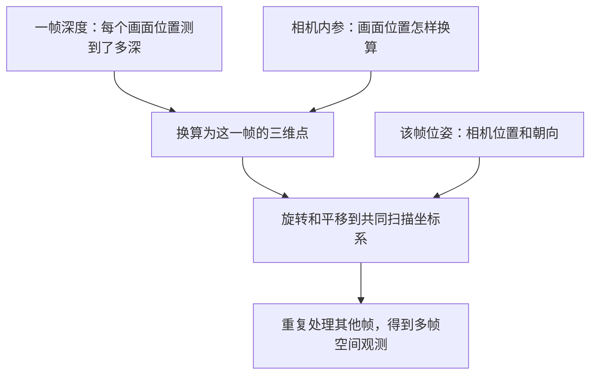

# 从解包到点云：直观理解版

本文用旧四份工程的 400×300 深度和坐标约定举例。新扫描实测为 800×600，且无需旧示例中的 Y/Z 翻转；“深度＋内参＋位姿”的原理相同，实际转换须读取工程索引中的坐标约定。见 [新工程研究记录](range2-study-20261018.md)。

**整个过程可以理解为：读出每个位置的深度，把它换成一个三维点，再根据扫描时相机的位置和朝向，把不同帧的点摆到一起。**

先把“一帧”想成扫描仪拍下的一张深度快照。一次扫描会留下很多帧，每一帧通常只看见物体的一部分。

## 1. 解包后，我们主要拿到三样东西

| 数据 | 用大白话理解 | 当前存在哪里 |
| --- | --- | --- |
| 深度图 | 画面中每个位置测到了多深 | 每帧 `frame.npz` 里的 `depth_mm` |
| 相机内参 | 画面位置与相机观察方向之间的换算规则 | 工程 `Pl.bin`，解包后记入 `index.json` |
| 相机位姿 | 拍下这一帧时，相机在扫描坐标系中的位置和朝向 | 每帧保存位姿，以及部分工程另存的全局位姿 |

其中，“深度图”可以想成一张填着数字的图片：普通照片的每个格子存颜色，深度图的每个格子存深度。

```text
一小块深度图，单位毫米：

       左边    中间    右边
上方    202     200     203
中间    201     198     202
下方      0     199     201
```

这里 198、200 等是测到的深度；**0 表示这个位置没有有效测量，不能拿它生成表面点。** 这个小表是教学示意。我们的实际单帧深度图是 400×300 个位置。

当前深度值表示沿相机前方轴的深度。中心附近可以直观理解成“在相机前面约多少毫米”；偏离中心后，还要结合画面位置才能确定三维坐标。

## 2. 第一件事：把一帧深度变成一片三维点

只有“深度 200 mm”，还不能确定一个点在哪里：它可能在相机正前方，也可能在偏左、偏右的位置。

所以程序同时看两个信息：

- **这个数值位于画面的什么位置？** 决定它相对中心向哪里偏。
- **这个位置的深度是多少？** 决定它在前方多深。

再用相机内参把这两个信息换算成 `(X, Y, Z)`。例如，正中间一个深度为 200 mm 的测量，可对应光学相机坐标中的 `(0, 0, 200)`；右侧另一个测量会有相应的水平坐标，具体大小由内参计算。

**对每个有有效深度的格子都这样做，就得到一片三维点，也就是这一帧的点云。** 这些点通常落在物体当时可见的表面上。

这里不要求有彩色照片。这批工程没有 RGB 纹理，也能靠深度恢复形状。

## 3. 第二件事：用相机位姿，把不同帧摆到一起

想象你拿扫描仪绕着一个胸像走：

```text
正面扫描：看到脸和前胸的一片点
侧面扫描：看到耳朵、侧脸的一片点
背面扫描：看到后脑和背部的一片点
```

每帧刚生成的点，都是以“这一帧相机所在的位置”为参照的。相机走动后，这个参照也变了。

保存位姿告诉程序：**把这一帧的点转多少、移多少，才能放回该次扫描共同的坐标系。**

因此，正面那片点放到前面，侧面那片点转到侧面，背面那片点放到后面；它们观测到的同一处表面应当尽量重合。

这一步依赖相机的**位置和朝向**，只有位置还不够。我们当前读取的是官方工程保存的位姿；有匹配的另存全局位姿时，默认优先使用它。



实际代码还会处理坐标轴方向和毫米/米换算，这些规则在当前四份工程中已经核对；直观上可以把它们理解为“大家统一使用同一把尺子、同一套方向”。

## 4. 第三件事：整理重复观测，生成融合结果

很多帧会反复看到同一个地方，比如鼻尖。由于测量噪声和位姿误差，这些点可能形成一小团，而不是完全重合成一个点。

我们现在有两种处理方式：

| 方式 | 直观理解 | 主要用途 |
| --- | --- | --- |
| 体素累计 | 把空间分成小格子，将同一格里的观测取平均，记录观测次数 | 检查原始观测、背景、重影和支持情况 |
| TSDF 融合 | 综合多帧对表面位置的判断，估计一层共同表面 | 生成当前主要的融合点云和三角网格 |

可以把最终几何分成两个概念：

- **点云**：很多三维点，表示表面大概在哪里。
- **网格**：用三角形表示连续表面，便于后续编辑、渲染和导出。

当前主链路由 TSDF 提取表面点云和网格。上面的“每帧点云 → 摆到一起”帮助理解几何关系；实际运行 TSDF 时，程序直接输入每帧深度、内参和位姿，不需要先给每一帧导出一个 PLY 文件。全观测体素分支则会明确投影各帧的点再累计。

## 5. 为什么失败扫描仍可能还原不好

这三类问题可以分别理解：

| 输入问题 | 还原后可能看到什么 |
| --- | --- |
| 某个地方没有有效深度 | 缺面或孔洞 |
| 深度测得不稳定 | 毛刺、粗糙表面 |
| 相机位姿有漂移 | 同一部位摆不齐，出现重影、双层或变形 |

所以，**成功把文件读出来，只说明拿到了保存数据；最终模型好不好，还取决于深度质量、位姿质量和融合方法。**

我们对失败扫描做的参考辅助修正，主要就是借助成功扫描，检查并调整“每一帧应该摆在哪里”，然后重新融合。它使用了额外参考，需要与原位姿基线分别评价。

## 6. 对照我们项目的一次实际处理

以 `scan_03` 为例：

```text
读取工程保存的 886 帧深度
        ↓
读取相机内参，以及每帧匹配的位姿
        ↓
将各帧测量解释到同一扫描坐标系
        ↓
筛选部分深度突变像素，进行 TSDF 融合
        ↓
提取约 17.1 万个表面点、34.2 万个三角形
```

886 帧是保存的深度帧数；最终点数不等于各帧有效像素数量之和，因为融合会聚合重复观测，并提取表面。

以上讲的是**一份扫描工程内部**如何重建。若要把两个扫描工程组合起来，还需要估计它们之间的整体相对位置和朝向，再决定哪些区域可以组合。

需要运行命令、精确坐标公式和输出目录时，再看 [完整链路与使用手册](offline-reconstruction-pipeline.md)。

想对照数组维度、二进制字段和真实单帧数值，可继续看 [按数据结构理解：解包数据怎样变成点云](depth-to-pointcloud-data-structures.md)。
