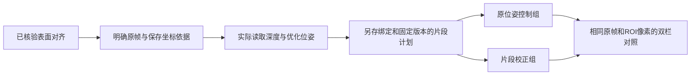

# 在网页中绑定原帧并重新融合

2026-10-22。当前实现处理**同一份解包工程中的两个明确片段**：先核验表面对齐，再确认原帧归属，从原深度重新融合。官方软件继续负责采集，SDK和实时读取仍后置。

## 如何使用

1. 在项目根目录运行 `scripts/start-web-studio.ps1`，打开 `http://127.0.0.1:8877`。在工程工作区选择扫描，再切到“对应点”。
2. 选择两份保留原保存扫描毫米坐标的模型，建立工作区，选择同一物理位置，计算变换，再点击“核对并另存对齐模型”。等待任务完成，回到工程工作区并刷新目录。后端会重新核对原模型和会话；前端的表面预览不能直接充当核验结果。
3. 展开“下一步：绑定原帧并重融合”，选择“已核验对齐”和具体候选。固定片段保持原位姿，移动片段应用源到目标的校正矩阵。
4. 明确两片段拥有的原帧。可以填写**原帧编号**，或**从1开始的保存记录序号**，用逗号和递增范围分隔。下方记录表列出二者的对应关系。两片段不得重复拥有同一原帧，未选记录保留。
5. 填写两份模型的帧归属、保存坐标依据和本次选择说明，确认两模型使用原保存扫描毫米坐标。可选ROI是这个原坐标系中的最小XYZ、最大XYZ，六个边界必须完整填写或全部留空。
6. 点击“核验原帧与输入版本”。后端实际解码选中深度、读取优化位姿，重新核验对齐结果并生成计划。审阅帧数、实际原ID、选区前深度观测数和固定文件数量。**编辑输入会使旧核验失效**；需要再次核验。
7. 点击“按此核验运行两组重融合”。页面进入处理任务，可以查看步骤、日志、独立结果目录和双栏对照。先执行原位姿控制组，再执行片段校正组；取消请求在步骤之间生效，不会强杀进行中的一次融合。

“先前记录的归属”必须选中并点击“载入归属与选区”才会填入。载入后仍需填写本次决定并确认依据；改变帧、ROI或依据会解除旧预设引用。系统不会根据PLY外形、显示顶点编号或文件名猜测原帧归属。

深度/位姿列的“存在”只是文件存在性。只有点击核验后，才实际检查内容；缺少 `pose_optimized.npy` 或载荷损坏会阻止执行，当前不自动改用其他位姿。

## 现有失败杯子示例

在有本机研究数据时，可直接打开：

```text
http://127.0.0.1:8877/?scan=scan_20261018131222&reconstruct=1#alignment
```

选择“已有研究回放 · 失败杯子局部组件”，候选 `selected_frozen_training_1_to_0`，再显式载入已记录归属。固定片段原ID为 `0-30`；移动片段为 `31-88,90-108,110-115`。注意原帧编号有空缺，不能填写成 `31-115`。

这是已冻结候选的114帧局部示例，另222条记录未加入。全部选中帧都参加生成表面，不能把这些帧再当独立留出评测。没有本机完整reports和原深度时，新克隆的仓库不会自动具备这个示例；可以查看[精简验证](../research/verification/2026-10-22-web-fragments/README.md)。

## 数据如何流转



目标片段使用单位校正；源片段的新相机位姿为 `校正矩阵 × 原优化位姿`。两组都按原优化位姿决定ROI所选像素，避免校正后改变取样范围。默认参数仍为0.6mm体素、2.4mm截断、3mm深度跳变筛除和提取权重3。2026-10-25起可在支持范围内编辑四项参数，进入已核验计划并用于两组；修改后必须重新核验。原帧范围、部分ROI和参数文本可独立保存草稿，见[帧编辑草稿](frame-editing-drafts.md)。

核验不会启动融合。它另存 `reports/web-studio/fragment-reviews/<编号>/binding.json`、`fragment-plan.json`、`review.json`。执行请求同时固定计划和核验记录的SHA；服务端重新核对记录、索引以及计划引用的深度、位姿、模型和来源文件。已提交的核验不可重复执行；重跑需生成新核验。

任务写入 `reports/web-studio/runs/<任务编号>/`。queued/running状态在执行前持久化；服务重启后，未完成旧任务显示为interrupted，用户可以检查日志并重新核验运行。完成任务保留 `result/review.html` 双栏模型、`result/index.html` 工作流记录和每步日志。它们是新派生结果，不自动提升为工程活动版本。现在可从处理任务点击“在工程中查看两组结果”，明确选择后登记命名版本；[模型版本切换与撤销重做](project-result-history.md)已接入。完整算法参数和帧编辑状态的回滚仍未实现。

## 接口和验证

- `GET /api/fragments/context?scan=<扫描ID>`：当前索引版本、已核验候选、可显式载入的归属记录，以及保存记录表。原ID以字符串返回，避免JavaScript大整数精度丢失。
- `POST /api/fragments/reviews`：提交归属和依据，实际读取数据，返回计划与核验SHA。使用当前索引和对齐版本；旧异步响应不会覆盖已编辑的表单。
- `POST /api/jobs`：`kind=fragment_fusion`，携带 `review_id`、`plan_sha256`、`review_sha256`，提交已核验版本。
- 原有任务查询与取消接口继续使用；所有接口只服务本机工作台，不连接语言模型或扫描仪。

启动服务后可执行真实接口回放，输出目录必须是新的：

```powershell
.\.venv\Scripts\python.exe scripts/check_web_fragment_fusion.py --port 8877 --out reports/new-web-fragment-check
```

2026-10-22真实回放完成114帧两组融合：67,226点与66,376点，各自与先前冻结结果的全点双向最大距离均为0mm。这说明新的Web执行链路复现既有结果，**不说明物理误差为0mm或整份失败扫描已修好**。同原像素摘要也一致。166项Python测试、前端实际控制器的模拟DOM检查以及共享查看器CPU像素检查通过；本轮没有新增Chrome实机/GPU观察，也没有人工选点。

底层JSON/CLI契约见[对应点结果到原帧重融合](fragment-fusion-bridge.md)。
