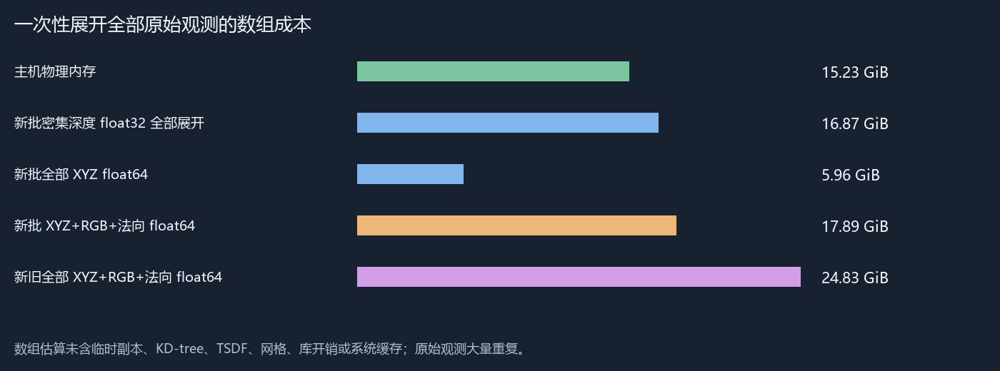
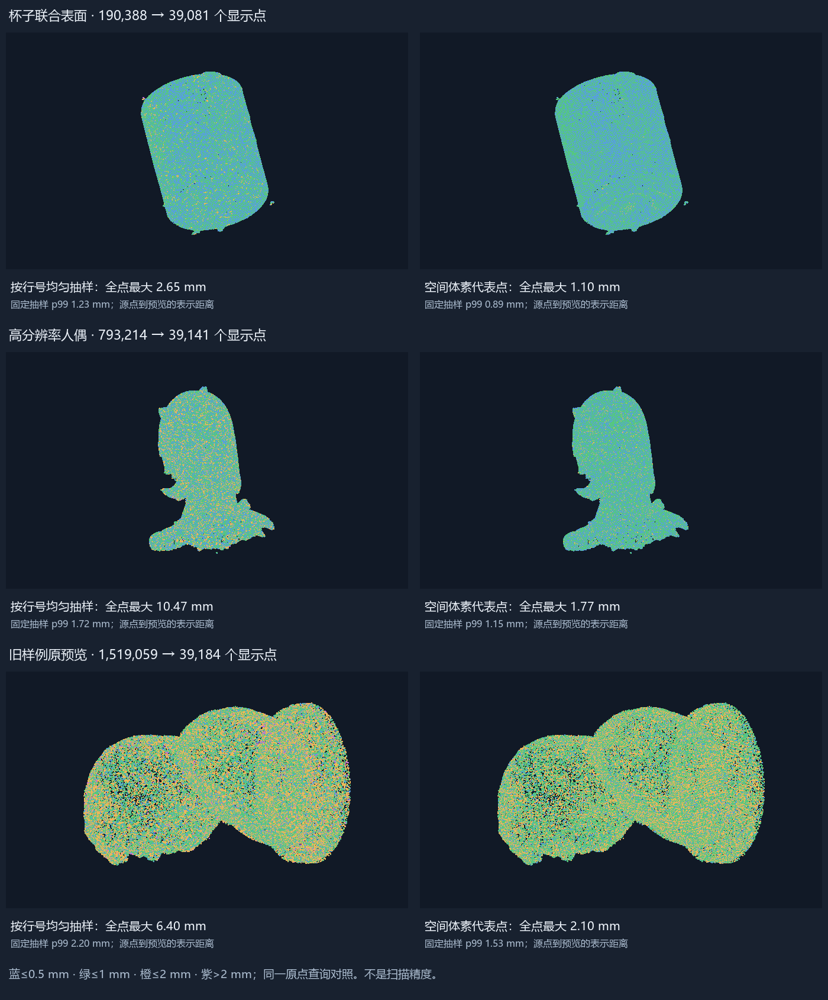
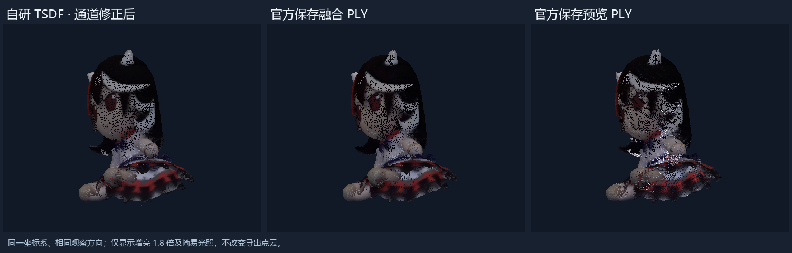
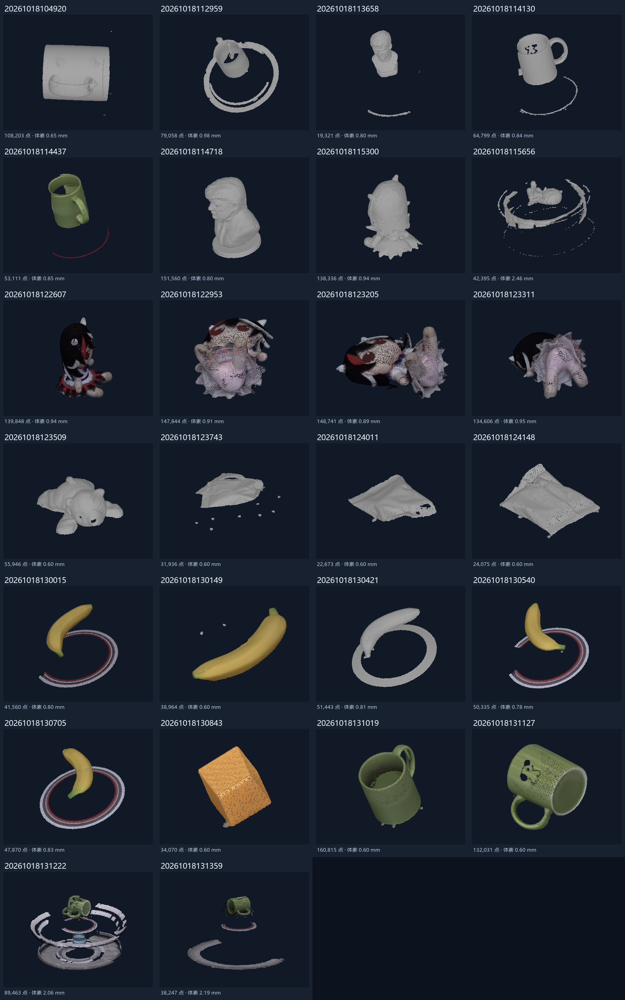
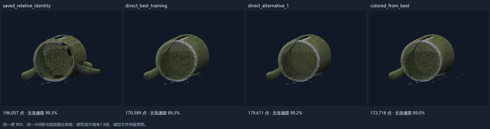
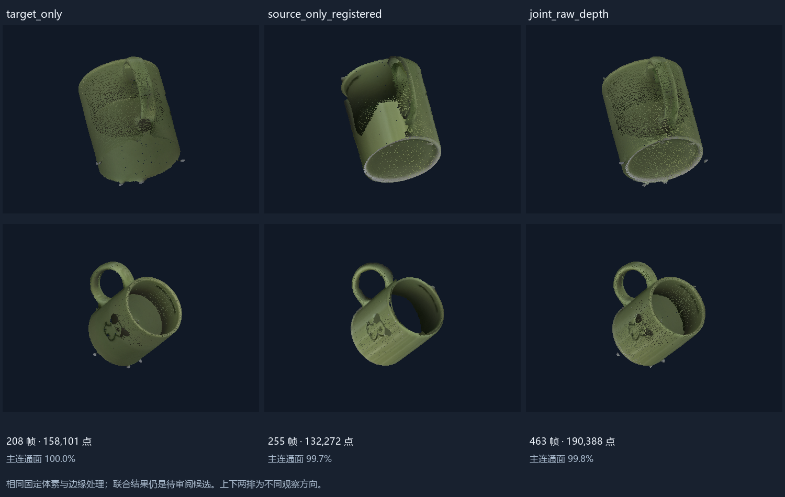
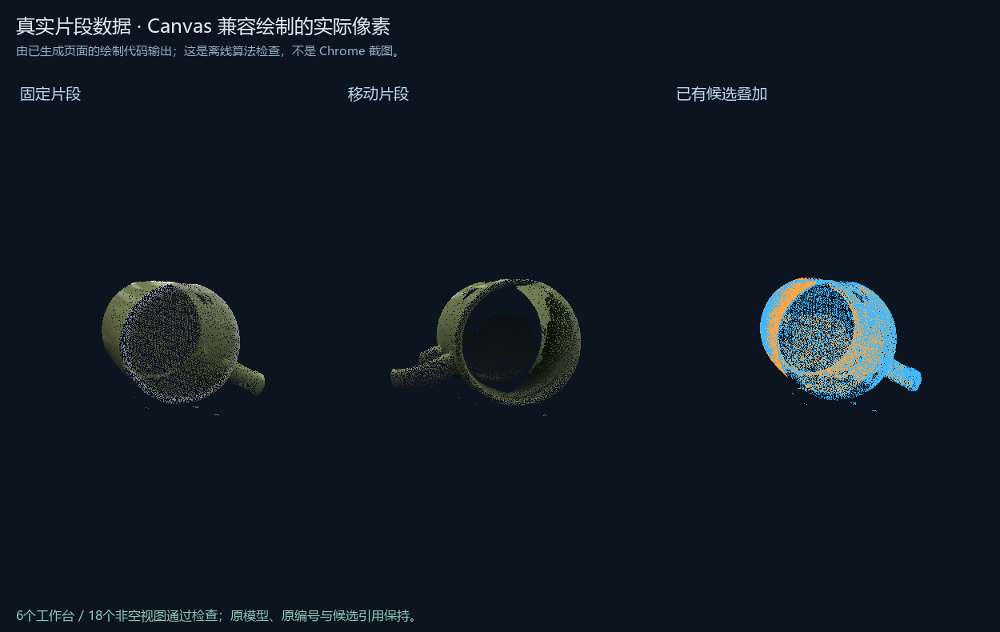

# 2026-10-20 研究成果快照

此目录随代码备份，保存已完成工作的关键数量、验证边界与真实结果图。完整扫描工程、逐帧数据、模型和运行环境继续保留在本机，不在此快照中。

新旧输入共 **11,932帧、370,243,304次有效深度观测**。新批26份主融合表面合计2,047,250点；精细人偶候选793,214点。观测包含大量重复，不能视为同样数量的独立表面点。

Web原型已接入33份工程、6个对应点工作台和22类实验。123项Python检查通过；已有真实HTTP处理与CPU像素检查。**实际Chrome画面与GPU仍待核验。**

| 已实现或研究内容 | 结果与边界 |
| --- | --- |
| 离线解析 | 深度、保存/优化位姿、颜色与标记；不能证明全部物理传感器帧都保存 |
| 独立与多扫描融合 | 同一工程片段358帧演示、两工程463帧联合深度融合；孔洞、重影与冲突继续保留 |
| 对应点与局部交互 | 原顶点编号、空间预览、磁盘索引、局部完整点；原坐标核对后另存对齐模型 |
| Web工作流 | 模型/原始帧/实验浏览、对应点提交、固定工具任务和日志；尚无模型Agent服务 |
| SDK与实时引导 | 暂时后置；补扫方向当前是离线建议 |

## 点云规模与预览

以上距离描述预览覆盖原模型的程度，不是物理扫描精度。

## 独立融合与官方同源结果

官方输出也不是独立物理真值，当前尚未证明自研结果全面优于官方。

## 片段与多扫描融合候选

## 对应点兼容绘制

此图由生成页面的CPU绘制代码输出，明确不是Chrome截图。

详细数量见 [research-summary.json](research-summary.json)，CPU实测见 [cpu-operation-measurements.json](cpu-operation-measurements.json)，图像来源与哈希见 [figure-provenance.json](figure-provenance.json)。恢复方法见 [备份与恢复说明](../../../docs/backup-and-restore.md)。
