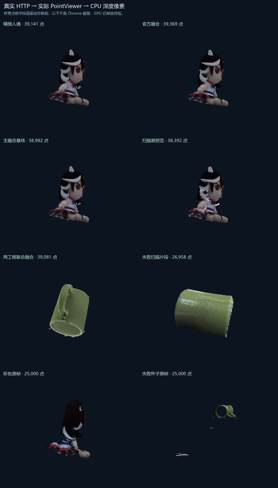

# 网页空白显示：已复现的问题与修复验证

用户反馈所有点云不显示。已确认接口返回的 `points` 是整数点数，旧viewer却优先把它当成坐标数组。原先HTTP检查只确认接口返回了数据，viewer检查只传typed-array，两者没有接在一起，因而漏检。

新增回归先在原实现复现“点云数组格式不完整”，再检查修复。前端明确判断数组类型；后端几何响应使用 `originalPoints` / `displayPoints` 表示数量，避免字段歧义。

8种实际输入通过真实本地HTTP返回，再交给实际PointViewer代码和CPU深度缓冲绘制，均产生非空像素：精细人偶、官方融合、主融合基线、扫描预览、两工程联合融合、失败片段、彩色原帧、失败杯子原帧。

**这不是Chrome截图，也不是实际GPU验证。** 它验证的是此前漏掉的数据契约和完整代码连接；用户实机反馈仍是最终界面检查所必需的证据。

另已完成：123项Python检查、项目模式保持的前端控制检查、7个对应点工作台的21个非空CPU视图。真实自选模型任务创建了官方533,469点与精细自研793,214点的对应点工作区。

复现脚本：`scripts/check_web_render_pipeline.py`。本地报告保存在 `reports/web-studio/render-fix-20261020/`，不随Git上传；这里仅保留结果图和简短方法。
