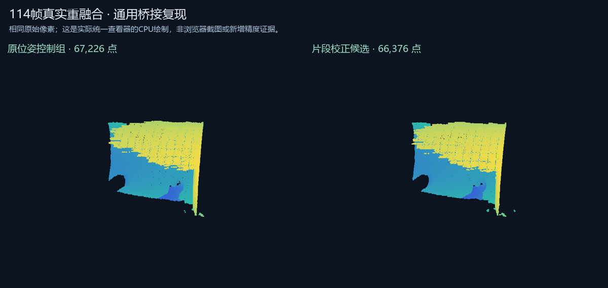

# 同工程对应点结果到原帧重融合：2026-10-21验证

已接收另一台电脑的17份同步文件，逐份匹配最后检查点；15份代码和文档先独立保存为提交 `37de939`。接回迁移到数据盘的扫描原件后，29份工程要求的388份文件、3,031,514,347字节均重新计算SHA，全部匹配原解包快照。

新能力是把核验过的表面对应点结果绑定到明确原帧，再真正重新积分原深度。固定工作流包含计划、保存位姿控制组、校正组。真实失败杯子组件共114帧，原目标31帧、移动83帧；完整源帧号得到保留，各帧只积分一次，两个组使用完全相同的原始ROI像素。238份输入被固定哈希，检查期间出现的新文件版本不能被误记为基线。

| 组别 | 融合后点数 | 与各自先前冻结结果的全部点双向最近邻最大差 |
| --- | ---: | ---: |
| 原保存位姿控制组 | 67,226 | 0mm |
| 片段校正候选 | 66,376 | 0mm |

这个0mm证明软件执行链路复现了之前结果，不是物体扫描精度为0mm，也没有新增几何改善的结论。本次是自动回放已冻结候选，没有人工选点。其余222条记录没有加入，整个336帧失败扫描尚未解决。

两组显示39,032和38,741个实际原顶点，实际共享PointViewer在CPU回退下分别产生49,545和47,791个可见像素。另8组真实HTTP响应到实际viewer、像素的检查通过。154项Python测试及3项Node回归通过；本轮没有新增实际Chrome/GPU验证。

[输入契约与使用方法](../../../docs/fragment-fusion-bridge.md) · [精简机器可读验证](result.json)

完整扫描与运行结果保留本机，未随公开仓库上传。当前网页入口由Web Studio实验目录提供；网页帧归属编辑、跨工程绑定、工程撤销历史和语言模型服务仍待实现。
