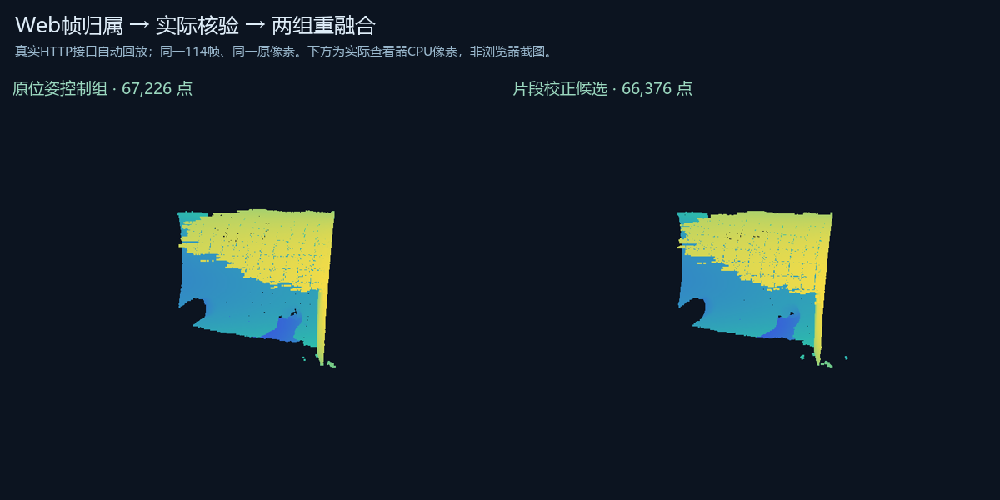

# 网页原帧归属到两组重融合：2026-10-22验证

新能力是把已核验的对齐结果接到网页内的原帧归属表单，实际读取深度/优化位姿并审阅计划，再按那个版本运行两组TSDF。表单集成在工程工作区的“对应点”模式；没有增加并列软件入口。

验证使用真实本地HTTP接口，从当前工程、显式载入的既有归属及冻结候选生成核验，再提交任务。错误计划版本在执行前被拒绝。239份输入版本得到固定；两组仍使用同一114帧和原ROI像素。原ID有间断，保留为字符串，避免浏览器大整数精度损失。

| 组别 | 生成点数 | 对各自先前冻结结果的全点双向最大距离 |
| --- | ---: | ---: |
| 原位姿控制 | 67,226 | 0mm |
| 片段校正候选 | 66,376 | 0mm |

0mm表明执行链路忠实复现既有结果，不能视作物理误差为0mm或新增精度改善。当前只验证失败杯子的114帧组件，另外222条保存记录未加入，336帧整份失败扫描尚未修好。这是自动回放已有候选，**没有人工选点或真实浏览器操作**。

实际共享查看器分别显示39,032/38,741个原顶点，产生49,545/47,791个非空CPU像素。页面数据与实际viewer代码相连；本轮没有新增Chrome/GPU验证。

166项Python测试通过，覆盖HTTP、显式原ID/序号、损坏载荷、重复归属、输入换版、版本固定、持久化恢复、并发任务保留与步骤间取消。实际网页控制器用模拟DOM验证显式载入、输入编辑失效、旧异步响应丢弃、跨工程切换、同版刷新保留草稿和提交两个SHA。另通过共享viewer CPU与对应点工作台Node检查。

开始与提交前检查GitHub，未发现其它电脑额外提交。扫描原件快照覆盖的29工程、388份文件、3,031,514,347字节重新计算SHA，全部匹配；这个文件内容检查不认证未列出的新增文件或几何精度。

[网页使用方法](../../../docs/web-fragment-workflow.md) · [机器可读结果与代码SHA](result.json)

本地完整记录：`reports/web-studio/fragment-editor-20261022/final/`；任务 `465fdb3b59b740b2`。完整扫描、原深度、运行日志和本机配置未上传到公开仓库。下一阶段是工程派生历史/撤销、跨工程坐标契约和失败片段的独立质量证据；SDK继续后置。
