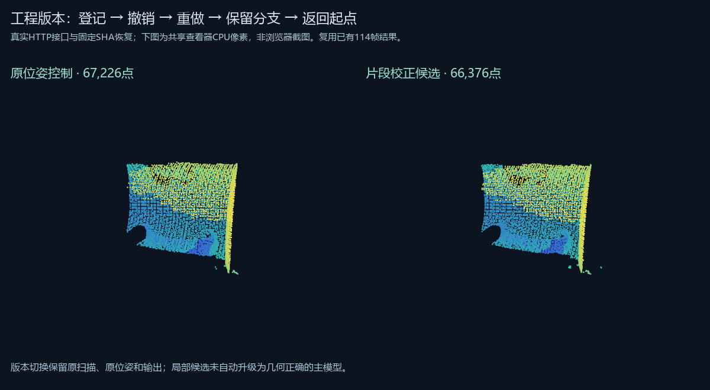

# 工程结果版本：2026-10-23验证

新能力是将工程当前选中的1至3份模型登记为固定版本，保留文件SHA和任务来源，支持切换、撤销、重做和分支。它集成在模型工作区；任务完成后可直接返回工程选择两组结果，候选不会自动被采用。

真实HTTP接口复用了已有失败杯子336帧基线和114帧原位姿/校正结果：登记起点、控制组、候选，撤销、重做，再从撤销位置另存两组比较分支，最后返回起点，共四个版本、八次操作。旧分支保留，新增分支清空重做栈。旧页面状态SHA和错误模型SHA被拒绝。

初次创建之后增加了只读的损坏/循环记录检查，最终服务重启后读回完全相同的状态SHA，四版本仍可用；没有重复添加候选。创建阶段与最终读回的代码SHA分开保存。最终点云接口仍按版本SHA核对，显示控制组9,657点、候选9,682点。

两组实际CPU可见像素为40,027和39,499。仍使用之前的67,226/66,376点完整局部表面；本轮没有重新融合、引入新采集观测或修好336帧整份失败扫描，也没有人工批准对应关系。

189项Python测试和六项Node检查通过。新增覆盖两服务并发、跨进程OS锁及退出释放、写入失败保留旧状态、版本分支、内容换版、损坏/循环历史、路径迁移、工作流输出SHA来源、固定预算/局部点读取及旧异步回复。实际控制器使用模拟DOM，本轮没有新增Chrome/GPU验证。

29工程原件快照要求的388份文件、3,031,514,347字节重新计算SHA，全部一致。文件内容相同不代表物理几何准确，也不覆盖快照没有列出的新文件。

[使用与状态模型](../../../docs/project-result-history.md) · [精简机器可读证据](result.json)

完整本机记录在 `reports/web-studio/project-history-20261023/`；活动版本恢复为原工程融合起点。工程版本JSON、扫描、完整模型与来源文件仍不上传公开仓库。独立电脑的Git代码同步不会自动迁移这些忽略目录。
