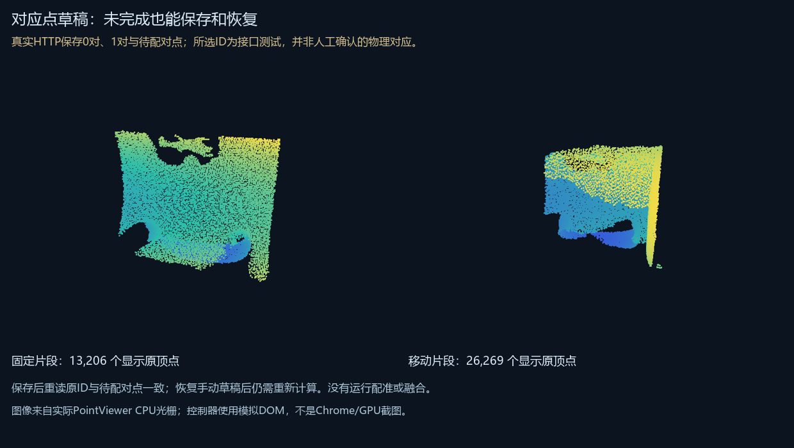

# 对应点草稿：2026-10-24验证

未完成的选点、已修改但未重算的手动选点和待配对固定点，可以保存为独立快照，按原工作区/模型/候选版本恢复。手动草稿不携带拟合矩阵，恢复后要求重新计算；不自动提交任务。服务升级旧页面时仅改变HTTP响应，历史文件SHA保持不变。

本轮真实HTTP往返保存两份清楚标记的接口验证草稿：零对选点，以及一对加一个待配对点。读回原顶点编号和坐标一致，旧状态SHA拒绝；随后重启读回相同状态。选点是自动接口夹具，不是人工确认的物理对应，没有运行对齐或融合。模型历史四版本状态SHA不变。

两片段显示13,206/26,269个原顶点，实际CPU可见69,415/43,703像素。实际HTTP服务响应中的网页控制器，通过模拟DOM读回草稿并导出完全相同的原ID与待配对点。不能据此宣称新增Chrome/GPU实机观察。

完整200项Python回归通过，新增11项草稿测试：原顶点及坐标验证、候选SHA、模型或页面换版、并发服务、锁竞争、写入中断、损坏状态、路径映射、HTTP来源校验。另有控制器异步回复、便携草稿、重新计算、覆盖半径和只在明确提交后发任务的Node检查。并发测试发现Windows首次创建锁的竞争，已将锁字节初始化移至获得锁之后；既有跨进程工程版本测试也通过。

29工程原快照的388份文件、3,031,514,347字节重新计算SHA一致。这里只保证列出文件的内容，没有新增物理几何真值或修好336帧失败扫描。

[用法与数据结构](../../../docs/landmark-drafts.md) · [精简机器证据](result.json)。完整本机记录在 `reports/web-studio/landmark-drafts-20261024/`。扫描、完整模型、历史页面和实际草稿状态继续留本地，不随公开Git备份上传。
