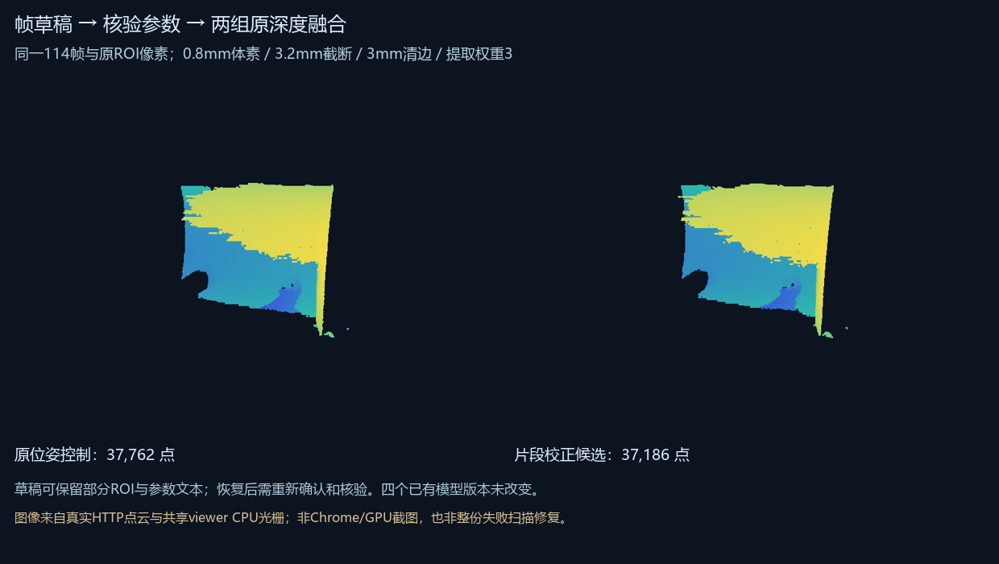

# 帧编辑草稿与参数执行：2026-10-25验证

可以独立保存原帧范围、依据、部分ROI和参数文本，支持明确恢复与便携JSON。服务保存索引/对齐/原模型来源版本；恢复不沿用坐标确认、预设引用或执行核验。实际载荷仍由随后明确核验读取，草稿不会自动运行任务。

真实HTTP保存两份明确标记的测试草稿，一份保留未完成范围 `31-88,`、部分ROI和空截断值，另一份保留114帧范围与0.8/3.2/3/3参数。实际服务的FrameEditor控制器在模拟DOM读回后导出一致JSON，并清除旧确认和核验；该控制器验收没有提交任务。另由明确的脚本研究步骤提交冻结组件核验与融合。

真实任务 `8197aff465a34cf7` 的原位姿组37,762点、片段校正组37,186点；两组都记录实际参数：0.8mm体素、3.2mm截断、3mm清边、提取权重3。原帧和ROI像素摘要与此前0.6mm实验一致，证明新参数链路实际工作。参数共同变化，点数减少不代表更高物理精度。仍仅114/336帧，另222条保留，没有修复整份失败扫描。

已有四个模型版本SHA不变，新结果没有自动采用。29工程原快照要求的388文件、3,031,514,347字节SHA全部一致。215项Python测试通过，含草稿、参数范围、计划与核验一致、读取竞态、两服务防覆盖和断写保留。Node测试实际控制器的异步回复、确认清除、JSON与参数更改后核验失效；没有新增Chrome/GPU实机证明。

[使用与结构](../../../docs/frame-editing-drafts.md) · [精简机器证据](result.json)。完整本地记录在 `reports/web-studio/frame-drafts-20261025/`；运行状态、完整报告和扫描不上传公开仓库。
