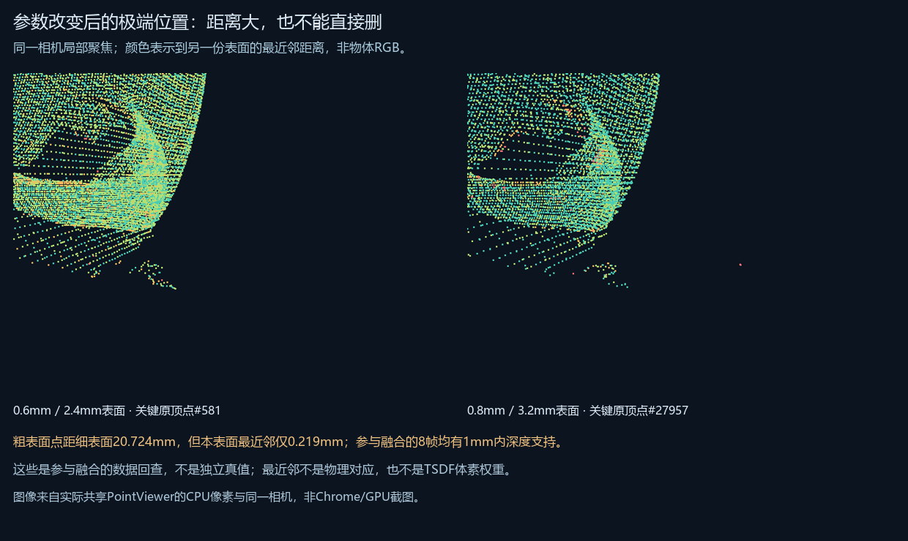

# 同帧参数响应：2026-10-25验证

完成草稿功能后先备份为 `2cae699`，再补跑当前默认控制 `8a0b007863984e19`，与0.8mm任务 `8197aff465a34cf7` 比较。相同当前入口脚本、每组229份原载荷和应用位姿数组、114原ID与ROI像素；没有再拟合。默认完整点集各自对历史任务双向最大距离0mm，是执行复现而非物理误差。

点数67,226→37,762、66,376→37,186，约少44%。四方向超过99.7%点在对方表面1mm内，但最大局部差异20.724mm，不能仅凭平均指标忽略。

极端0.8mm点#27957本表面最近邻仅0.219mm，帧32/33/34/35/37/41/96/98均有1mm内投影深度支持。跨表面距离大不等于噪点。校正组另一个极端的最近粗点在2mm下0支持/10冲突/3遮挡，也提示最近点并非物理对应，仍需体素级来源追踪。

原深度回查先ROI后3mm清边，像素摘要和积分一致。使用全部参与融合数据，非独立真值或TSDF体素权重。体素和截断共同变化，不能归因单项或自动认定参数更好。仍114/336帧，没有修复整份失败扫描。

实际生成页面4种全局切换、16段子页脚本语法、2种局部切换、两侧关键原ID与投影计数均已检查；共享viewer CPU在同一局部相机得到54,759/39,328可见像素。没有新增Chrome/GPU观察。核心215项Python回归属于前阶段已验证实现，本阶段独立分析和展示不修改核心拟合/融合算法。

[方法与复现](../../../docs/fusion-setting-response.md) · [完整数值与SHA](result.json)。本机统一入口 `reports/range2-study-20261018/experiments/fusion-setting-response-20261025/current-review.html`；原件、完整模型和逐视图数组仍不上传公开仓库。
